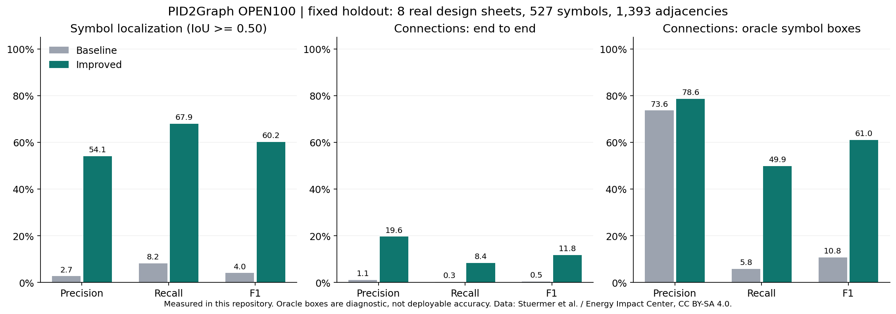
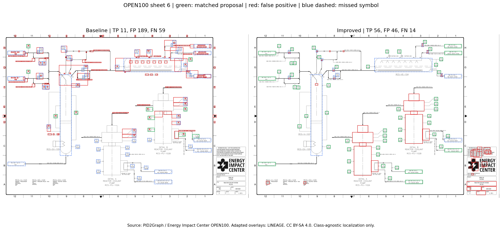
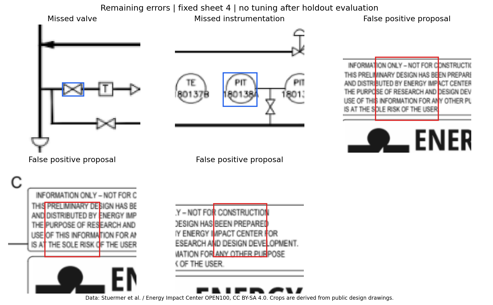

# 공개 실제 도면 평가와 추출기 개선

평가일: 2026-10-28 · LINEAGE CPU 추출기 v2

**공개 실제 설계 도면의 보류 평가 8장에서 기호 위치 F1은 4.04% → 60.22%, 연결 F1은 0.46% → 11.76%로 개선됐다.** 연결 재현율은 8.40%에 머물러 자동 영향 분석에 사용할 수준은 아니다. 이번 변경은 위치 후보와 연결 후보의 개선이며, 밸브·펌프의 의미 분류나 국제표준 식별자 인식 성공을 뜻하지 않는다.

## 데이터와 평가 분리

[PID2Graph v1 원본](https://zenodo.org/records/14803338)의 `Complete/PID2Graph OPEN100` PNG·GraphML 12쌍을 사용했다. 원본 도면은 Energy Impact Center의 [OPEN100 공개 설계](https://www.open-100.com/)에서 왔다. 실제 공개 엔지니어링 설계 문서이며 가동 중인 설비의 검증 자료는 아니다. 같은 아카이브에 있는 합성 도면은 이번 점수에 포함하지 않았다.

- 개발: ID `0, 1, 2, 3` — 기호 227개, 대상 기호 간 연결 678개.
- 보류 평가: ID `4, 5, 6, 7, 8, 9, 10, 11` — 기호 527개, 연결 1,393개.
- 분리는 개발 예측을 보기 전에 [protocol.json](protocol.json)에 고정했다. 보류 결과를 본 뒤 추출 파라미터를 조정하지 않았다.
- [frozen_config.json](frozen_config.json)은 보류 평가 전의 운영 코드 SHA-256과 조정 조건을 기록한다. 원본 파일 SHA-256·ZIP 내 경로·CRC32는 [data_manifest.json](data_manifest.json)에 있다.
- 데이터 라이선스는 Zenodo API의 `metadata.license.id=cc-by-sa-4.0`으로 확인했다. 출처·변경 내용·파생 그림/결과의 CC BY-SA 조건은 [NOTICE.md](NOTICE.md)에 기록했다. 원본 데이터는 Git에서 제외하고 별도로 받는다.

이는 **동일 프로젝트에서 나온 12장**의 제한된 평가다. 다른 회사의 P&ID, 건축 평면도, PCB, DXF 전체의 일반화 성능으로 확대해 해석하면 안 된다.

## 무엇을 점수로 계산했는가

기호 위치의 주 지표는 **IoU ≥ 0.50에서의 클래스 무관 일대일 검출 P/R/F1**이다. 기호를 얼마나 정확한 영역으로 분리했는지 측정한다. 예측 수와 정답 수의 차이, 중복 검출, 누락을 모두 계산하며 단순 개수 일치율이나 mAP가 아니다. 최대 매칭 수를 찾는 이분 그래프 매칭을 사용한다. IoU 0.25 결과도 보조 지표로 함께 저장했다.

정답 대상은 `valve`, `instrumentation`, `tank`, `pump`, `inlet/outlet` 5종이다. OCR 문자는 위치 평가에서 제외한다. 대상 외 도형을 예측한 경우도 FP로 계산하므로 화살표·일반 기호·표의 검출은 이 점수에 도움이 되지 않는다. 운영 추출기는 계속 `kind=unknown`, `status=needs_review`를 반환한다. 의미 종류를 올바르게 자동 분류한 수는 **0**이며, 위치 검출 점수를 의미 분류 점수로 사용하지 않는다.

연결은 다음처럼 계산했다.

1. 정답 그래프에서 대상 기호 사이의 connector·crossing·arrow·general 경로를 축약한다. background는 통과하지 않는다.
2. 다른 대상 기호를 만나면 그 경로 탐색을 멈춘다. A–B–C를 A–C로 확장하지 않는다.
3. 예측 기호를 IoU 기준으로 정답과 매칭한 뒤, 무방향 연결 쌍을 비교한다. 양 끝점이 매칭되지 않은 예측 연결도 FP에 포함한다.
4. 선 종류·방향·제어 의미는 평가하지 않았다. 이는 위 5종 기호 사이의 주석 기반 인접 관계 평가다.

별도의 **정답 기호 영역을 제공한 연결 진단(oracle boxes)**은 위치 검출 오류를 제거했을 때 연결 추적기가 어느 수준인지 분리한다. 정답 영역은 이 진단에서만 사용하며 운영 추출이나 실제 end-to-end 점수에는 들어가지 않는다.

## 보류 평가 결과

8장 전체의 TP/FP/FN을 합쳐 계산한 micro 지표다. 두 버전 모두 전체 도면을 자르지 않고 운영 미리보기와 같은 최대 2400px로 처리했다.

| 지표 | 기존 P | 기존 R | 기존 F1 | 개선 P | 개선 R | 개선 F1 |
|---|---:|---:|---:|---:|---:|---:|
| 기호 위치 · IoU 0.50 | 2.69% | 8.16% | 4.04% | 54.08% | 67.93% | **60.22%** |
| 연결 · end-to-end | 1.14% | 0.29% | 0.46% | 19.63% | 8.40% | **11.76%** |
| 연결 · 정답 영역 진단 | 73.64% | 5.81% | 10.78% | 78.62% | 49.89% | **61.05%** |

| 계수 | 기존 TP / FP / FN | 개선 TP / FP / FN |
|---|---|---|
| 기호 위치 | 43 / 1,557 / 484 | 358 / 304 / 169 |
| 연결 | 4 / 347 / 1,389 | 117 / 479 / 1,276 |

연결 TP는 늘었지만 FP의 절대 수도 347→479로 늘었다. F1 개선만 보고 연결을 신뢰하면 안 된다. 이 버전은 승인 전 검토가 필요한 후보 추출기로 사용해야 한다.



보조 IoU 0.25의 기호 위치 F1은 12.32%→67.12%, 연결 F1은 0.92%→21.62%다. 주 결과를 높이기 위해 매칭 기준을 완화하지 않았다.

| 보류 도면 ID | 기존 위치 F1 | 개선 위치 F1 | 개선 연결 F1 |
|---|---:|---:|---:|
| 4 | 5.86% | 58.33% | 11.35% |
| 5 | 2.92% | 67.07% | 8.73% |
| 6 | 8.15% | 65.12% | 8.62% |
| 7 | 9.96% | 51.39% | 11.11% |
| 8 | 1.69% | 60.00% | 10.71% |
| 9 | 0.00% | 62.96% | 28.57% |
| 10 | 3.46% | 55.72% | 8.03% |
| 11 | 0.00% | 61.45% | 11.80% |

원시 수치·각 예측은 [results/](results/), 도면별 CSV는 [per-sheet.csv](results/per-sheet.csv)에 있다. 개발 4장의 최종 동일 환경 비교에서는 위치 F1 8.37%→48.04%, 연결 F1 0.23%→8.32%였다. 초기 개발 실험의 OCR 5.5.0 수치는 최종 점수에 섞지 않았다.



초록은 매칭된 예측, 빨강은 FP, 파란 점선은 놓친 정답이다. 그림용 도면 ID는 6으로 고정했으며 최고 점수 도면을 고른 것이 아니다.

## 반영한 개선

운영 코드는 [backend/geometry.py](../backend/geometry.py), 연결 지점은 [backend/extract.py](../backend/extract.py)다. 추가 학습 모델·유료 API·정답 기반 템플릿은 사용하지 않았다.

- **원 둘레 검증:** Hough 원 후보에 실제 잉크의 둘레 지지율·사분면별 지지율을 확인한다. 배관의 모서리와 글자를 원으로 잘못 검출하는 경우를 줄인다. 원이라는 이유로 계기나 펌프라고 분류하지 않는다.
- **폐곡선 후보:** 선을 지운 영상의 조각만 쓰지 않고 원 영상의 닫힌 영역을 함께 읽는다. 붙어 있는 작은 대칭 도형의 두 부분을 기하 조건으로 합친다.
- **문자와 기호의 분리:** 기호 안에 OCR 문자가 있어도 큰 폐곡선 외곽을 지우지 않는다. 작고 OCR과 겹치는 문자 조각은 억제한다.
- **선 접점 검사:** 후보의 중앙 측면에서 이어지는 선의 근거를 확인해 도곽·표 조각의 일부를 억제한다. 지원되는 폐곡선이 없으면 기존 계열의 연결요소 fallback을 사용한다.
- **짧은 선과 꺾임 보존:** 수평·수직 형태학 마스크를 따로 분석해 선분을 만든다. 큰 Hough 선분 하나로 설명되지 않는 꺾임과 분기를 추적할 수 있다.
- **기호를 경로 장벽으로 사용:** 선 컴포넌트에서 기호 내부를 잘라내 중간 기호를 건너뛴 전이 연결을 줄인다. 미세한 래스터 간격만 닫고, 길게 끊긴 선을 임의로 잇지 않는다.
- **후보 예산:** OCR이 요소 500개 한도를 모두 차지해 기호 후보가 사라지는 일을 막도록 비문자 후보 공간을 확보한다. 복잡한 선망에서 무제한 연결 쌍이 생기지 않도록 기존 후보 상한도 유지한다.

PNG/JPG와 스캔·혼합 PDF의 래스터 경로에 위치 개선이 적용된다. DXF·벡터 PDF도 공통 연결 추적기를 사용한다. **이번 정량 성능은 공개 PNG 도면에서 측정했으며 DXF/벡터 PDF의 정확도 수치로 사용하지 않는다.** 데이터베이스 변경이나 기존 검토 결과의 재작성은 하지 않는다. 배포 후 새 분석부터 적용되며 기존 승인 도면을 새 결과로 비교하려면 별도 업로드가 필요하다.

## 남은 오류와 다음 우선순위



작은 밸브·액추에이터가 붙은 복합 기호·원 내부 선·열린 기호가 여전히 누락된다. 안내문·로고 일부는 닫힌 기하 도형으로 남는다. 픽셀 선망은 접속점 없는 교차와 실제 분기를 완전히 구분하지 못하고, 점선·문자에 가려진 선·수평/수직이 아닌 래스터 선에도 취약하다. 연결 F1 11.76%와 정답 영역 진단 F1 61.05%의 차이는 검출 오류와 기호 영역이 다른 배관을 가리거나 가짜 요소가 선망을 끊는 문제까지 포함한다. 이를 검출기만 교체하면 61.05%를 보장한다는 뜻으로 해석하면 안 된다.

다음 구현의 우선순위는 다음과 같다.

1. 개발용 데이터와 별도 공개/승인 학습 데이터로 도메인 기호 검출기를 학습하고 작은 기호 타일 검출을 추가한다. 보류 8장은 학습에 넣지 않고 향후 다른 프로젝트 도면을 추가한 고정 평가셋도 마련한다.
2. 포트·접속점·비접속 교차·선 종류를 별도로 검출한다. 현재 픽셀 컴포넌트 방식과 연결 그래프를 함께 평가한다. 정답 기호 영역 진단을 유지해 연결기의 개선 여부를 별도로 확인한다.
3. OCR 태그를 도형에 연결하고, 검출된 종류·태그·표준 근거를 각각 저장한다. 사용자가 승인하기 전에는 국제표준 식별자를 자동 확정하지 않는다.

[PID2Graph 저자 논문](https://arxiv.org/abs/2411.13929)은 기호와 그래프 연결을 함께 다루는 학습 모델의 다음 비교 대상으로 적합하다. 논문의 성능을 이번 CPU 추출기의 성능으로 인용하지 않았다.

## 실행 환경과 재현

기존 코드는 배포 앱 커밋 `6847bdf9b929965aae0328101b42f3c0ea9d4e1e`에서 불변 스냅샷으로 읽었다. 최종 비교의 양쪽에 같은 Tesseract 5.3.0, 운영 이미지에서 꺼낸 eng/kor traineddata, OpenCV 4.12.0, Pillow 12.0.0, Python 3.12.14를 사용했다. OCR 핵심 바이너리와 데이터는 운영 이미지와 같지만 호스트의 일부 공유 라이브러리·CPU 환경까지 운영 컨테이너와 같지는 않다. 운영 서버에서 업로드한 정확도 측정은 아니며 로컬 추출 경로의 비교다.

보류 도면 한 장의 OCR+기호+연결 처리 평균은 기존 1.391초, 개선 1.424초였다. 정답 영역 진단, 파일 업로드, 서버 큐, 미리보기 저장 시간은 제외했으며 부하 시험이나 서비스 SLA를 뜻하지 않는다.

```bash
# 운영용 requirements에는 시각화 도구를 추가하지 않았다.
.venv/bin/pip install -r requirements-eval.txt
# Tesseract 5.3.0 + eng/kor 언어 데이터가 PATH에 있어야 최종 조건에 가깝다.
.venv/bin/python scripts/fetch_public_benchmark.py
.venv/bin/python evaluation/benchmark.py --extractor-ref 6847bdf --split development --output evaluation/results/baseline-development
.venv/bin/python evaluation/benchmark.py --extractor-ref 6847bdf --split holdout --output evaluation/results/baseline-holdout
.venv/bin/python evaluation/benchmark.py --split development --output evaluation/results/improved-development
.venv/bin/python evaluation/benchmark.py --split holdout --output evaluation/results/improved-holdout
.venv/bin/python evaluation/render_report.py
.venv/bin/python -m pytest -q
```

`OMP_NUM_THREADS=1`을 사용했다. 다운로드는 ZIP64의 필요한 바이트 범위만 읽어 약 16.7MB를 전송했고 전체 9.3GB 아카이브는 받지 않았다. 각 멤버의 CRC32와 고정 SHA-256을 확인한다. 재실행 시 데이터·바이트 범위 캐시를 재사용한다.

평가 매칭·중간 기호에서 멈추는 정답 축약·꺾인 연결·거짓 근접 연결 차단·내부 OCR과 외곽 보존·JSON 직렬화는 회귀 테스트로 검증한다. 기존 업로드·검토 저장·사전·인증 흐름의 테스트도 유지했다. 최종 회귀 테스트 **14개 통과**(2026-10-28, 7.39초).

## 운영 반영

이 보고서는 로컬에서 검증한 개선 코드의 측정 기록이다. 서비스 반영에는 같은 커밋의 CI 컨테이너를 빌드하고 `deploy/k3s_deploy.py`로 갱신해야 한다. 현재 실행 환경에서는 `sudo -n`이 대화형 인증을 요구하므로 운영 클러스터 갱신은 직접 완료하지 못한다. 배포 전 서비스에서 이 개선 수치를 확인했다고 주장하지 않는다. 배포 명령과 검증된 컨테이너 artifact는 릴리스 결과에 함께 제공한다.
