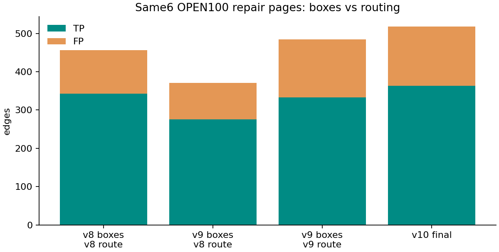
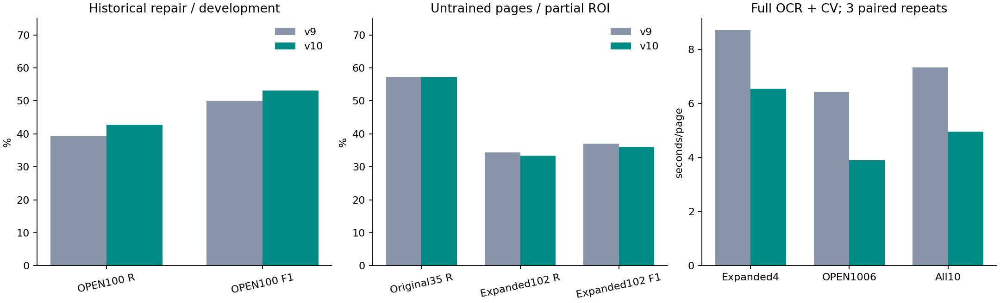
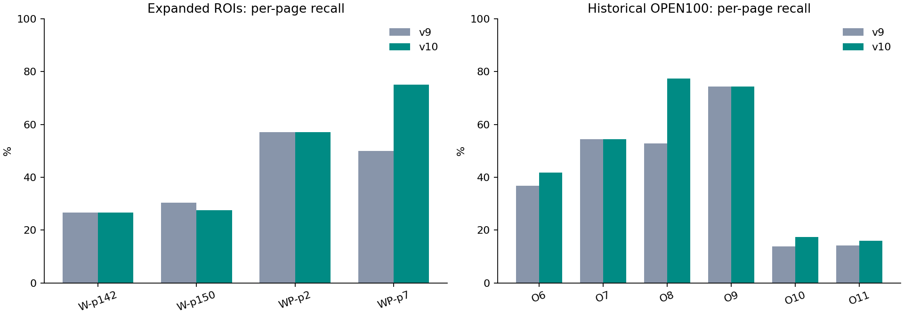

# v10: OPEN100 회복·추론 속도 개선과 확장 평가

**결론:** 이전 새 도면35연결 재현율57.14%를 유지하며 OPEN100 6장 연결 F1을50.00%→53.15%, 재현율39.27%→42.81%로 회복했다. 같은 실제10페이지의 장별3회 중앙값 평균 처리 시간은 7.339초 → 4.959초 (32.4% 단축)다. **확장한102연결에서는35→34개로1개 감소**했고, 합성 회귀도 소폭 하락했다. 모든 양식에서 정확도가 좋아졌다고 주장하지 않는다.

## 원인과 변경

기호 추가 미세조정 뒤 OPEN100 기호 TP339→330, FP7→19, FN41→50이었다. 이전에 맞혔다가 잃은71연결 중43개는 끝 기호 누락,28개는 기호가 대응한 뒤의 추적/접촉 누락이다. 박스 위치가 조금 이동해도 선이 기호 면에 닿는 판단이 바뀐다. 같은 v9 기호로 v8 추적을 쓰면 연결TP276이고, v9 추적은333개로57개를 회복하지만 FP도95→151개로 늘어난다. 기호 모델과 경로의 상호작용이며, 점선 기능 하나만의 문제로 설명하지 않는다.

- **단일 모델 복원:** 이미 학습한 v6 epoch16과 v9 scale epoch8의 모든 부동소수 텐서를0.5:0.5로 결합했다. BN 통계도 포함하고 정수 버퍼는v9를 쓴다. 추가 경사 학습이나 이중 신경망 추론을 하지 않는다. 개발 비교에서 계수0.25/0.5/0.75, 끝 모델들, 마지막0.45 문턱2개를 비교했다. 최종 문턱0.6, neural_only, 추가 확대0타일이다. 새 정부 도면/운영 업로드는 경사 학습에 쓰지 않았다.
- **중복 계산 제거:** neural_only에서도 생성한 뒤 버리던 전체 페이지 형상 템플릿 제안을 없애고, 신경망 박스·기존 형상 힌트 주변의 NCC와 실제 선 지지로 라우팅 양식만 확인한다. 프로파일에서 과거 전체 검색이 페이지당2.2–2.6초를 썼다. 로컬 양식 게이트는 실제 동작 변경이며 모든 입력에서 기존과 완전히 같은 결과라고 주장하지 않는다.
- **픽셀 계산 재사용:** 겹친 타일마다 RGB 최소값을 다시 구하던 흰 배경 검사를 한 번의 적분 영상으로 바꿨다. 희미한 색 선도 같은249 경계로 유지한다. 점선의 실제 잉크 run/gap 판정을 배치 계산한다. 임의 빈 공간을 연결하는 기준은 추가하지 않았다.
- **선택하지 않은 실험:** 실제 경로를 통과한 접점 점수로 추가 경로를 거르는 방법과 점선/실선별 문턱도 비교했지만, 기존 새 도면 재현율과 OPEN100 회복 조건을 함께 만족하는 더 나은 조합으로 선택되지 않았다. 최종 효과로 설명하지 않는다. 접점 점수는 진단 정보로만 남는다. 기존 점선 복구·점 없는X 분리·포트/접점 RTrees·기호200/연결500 상한·needs_review를 유지한다.

## 데이터 역할과 확장 정답

OPEN1006–11은 이미 반복 관찰한 과거 회귀이므로 **이번에는 회복용 개발 데이터**로 명시 전환했다. 이전 Winkler/Winnipeg35기호·35연결도 보존 조건 선택에 썼다. 따라서 이 수치를 미지 프로젝트 일반화로 소개하지 않는다. 최종 선택은7개 개발 층의 평균(connectionF1+.25symbolF1)을 최대화하되 OPEN100 재현율/F1이v8 이상이고 이전4영역 각각의 정답 연결4/8/6/2개를 유지해야 한다. 선택 목적값0.6974는 정확도%가 아니다.

원래 경사 학습 자료는v9와 같으며 새 정부4페이지는 포함하지 않는다. 확대 정답은 원본만 보고 전사하고4개 오버레이를 확인한 뒤, 최종 채점 전에 고정했다. 최종102개 연결 중67개는 새로 주석한 영역의 연결이다. 기존35기호 박스와35연결은 그대로다. **단일 AI 주석이며 전문가/독립 이중 검수 정답이 아니다.** 전체 이미지·프로젝트는v9 및 이번 이전 ROI 개발에 노출됐고, 확장 정답만 선택에서 제외했다. 새 프로젝트/최초 이미지 블라인드 시험이라고 부르지 않는다.

| 페이지 | 기존→확장 기호 | 기존→확장 연결 | 영역 면적 배수 | 페이지 중 평가 면적 |
|---|---:|---:|---:|---:|
| winkler-p142 | 12→16 | 12→15 | 6.13배 | 45.38% |
| winkler-p150 | 9→42 | 12→69 | 10.08배 | 73.15% |
| winnipeg-p2 | 11→14 | 9→14 | 2.50배 | 24.99% |
| winnipeg-p7 | 3→6 | 2→4 | 4.46배 | 2.31% |

Winkler는WWTP upgrade project60430450, Winnipeg2는NEWPCC BNR upgrade Contract3, Winnipeg7은WEWPCC WEP-91이다. 자료집2개·실제 시설 사업3개이며 양식/설계회사 독립을 보장하지 않는다. Winnipeg7은 여전히 두 계기 연쇄만 평가하는 작은 띠 영역이다. 정부 호스팅이 원본 재배포 허락을 의미하지 않아 PDF·페이지·오버레이·전체 OCR은 Git/이미지에서 제외한다.

## 결과: 기호와 연결

| 집합/버전 | 기호 TP/FP/FN | 연결 TP/FP/FN | 연결 P/R/F1 |
|---|---:|---:|---:|
| OPEN1006장 · v9 | 330 / 19 / 50 | 333 / 151 / 515 | 68.80% / 39.27% / 50.00% |
| OPEN1006장 · v10 | 334 / 11 / 46 | 363 / 155 / 485 | 70.08% / 42.81% / 53.15% |
| 확장4영역 · v8 참고 | 54 / 41 / 24 | 18 / 42 / 84 | 30.00% / 17.65% / 22.22% |
| 확장4영역 · v9 | 59 / 37 / 19 | 35 / 52 / 67 | 40.23% / 34.31% / 37.04% |
| 확장4영역 · v10 | 58 / 40 / 20 | 34 / 53 / 68 | 39.08% / 33.33% / 35.98% |
| 합성8장 · v9 | 570 / 33 / 7 | 2212 / 386 / 4374 | 85.14% / 33.59% / 48.17% |
| 합성8장 · v10 | 575 / 43 / 2 | 2200 / 380 / 4386 | 85.27% / 33.40% / 48.00% |

이전 OPEN100 v8 연결343/113/505, P75.22%·R40.45%·F152.61%보다 v10의 재현율/F1은 높지만 정밀도는 아직 낮다. v10에서도 OPEN1009의FP0→13,11의FP55→62처럼 나빠지는 페이지가 있어 합계만 보지 않도록 아래 CSV/장별 그래프를 제공한다.

확장 평가에서 v8보다 정답 연결18→34개로 이전 개선은 상당 부분 유지되지만, **이번 v9 대비는35→34개, R34.31→33.33%, F137.04→35.98%로 하락**했다. Winkler150에서2개를 잃고 Winnipeg7에서1개를 더 회복했다. 큰 탱크·분기·외부 연결 표지까지 늘리면 작은 이전 ROI 성능을 그대로 기대할 수 없다. 이를 보고 새 문턱을 조정하거나 정답을 고치지 않았다.

| 별도 범위 | v9 연결 TP/FP/FN | v10 연결 TP/FP/FN | v9→v10 R/F1 |
|---|---:|---:|---:|
| 원래35연결 | 20 / 10 / 15 | 20 / 11 / 15 | 57.14%/61.54% → 57.14%/60.61% |
| 새 주석 연결67개 | 15 / 51 / 52 | 14 / 51 / 53 | 22.39%/22.56% → 20.90%/21.21% |

확장 연결 부분집합은 전체 ROI의 동일 일대일 대응 뒤, 양 끝이 모두 기존 정답인 쌍을 제외해 채점했다. 미대응 후보는 FP로 남아 보수적인 분해이며 독립 표본67개를 뜻하지 않는다. 기호 IoU≥0.5 최대 일대일 대응, 중간 의미 기호에서 멈추는 무방향 인접 관계, 미검출 기호의 연결도FN, 영역 내 모든 후보의FP를 유지한다.

## 처리 시간과 확인 범위

전체 실제10장×2버전×3반복=60회. 버전 순서를 번갈아 실행했고 박스·연결·포트·접점·경로 결정성을 확인했다. 동일 RGB 원본에서2400px 보기와4800px 기호 입력을 독립 축소한다. OCR·기호·선·포트·접점·추적을 모두 포함하며 디코딩·PDF렌더·네트워크·저장은 제외한다. 모델 초기 실행은 두 버전에 공평하게 측정 밖에서 준비했다. OpenCV2/OMP1 CPU 측정이며 운영 동시처리량·SLA가 아니다.

- 확장 실제4장: 8.706초 → 6.543초 (24.8% 단축)
- OPEN100 실제6장: 6.428초 → 3.903초 (39.3% 단축)
- 합친 실제10장: 7.339초 → 4.959초 (32.4% 단축)

합성8장은 품질 회귀로 각 버전1회, 총16회다. 단발 시간을 속도 비교에 섞지 않았다. 합성 F1은48.17→48.00%, R33.59→33.40%로 소폭 하락했다.

[원시 결과](results/report.json) · [OPEN100 회복](repair/report.json) · [합성 회귀](synthetic/report.json) · [장별 CSV](per-page.csv) · [선택 전 실험 전체](RELEASE-SELECTION.json) · [고정 정보](FROZEN.json) · [재현](README.md) · [모델 카드](MODEL-CARD.ko.md)

원본 출처: [Winkler](https://www.manitoba.ca/sd/eal/registries/2708.2winkler/nov2016noa.pdf), [Winnipeg](https://www.winnipeg.ca/finance/findata/matmgt/documents/2015/382-2015/382-2015_ADDENDUM_2/382-2015_Addendum_02-Appendix_M_PID_Drawings.pdf), [PID2Graph](https://zenodo.org/records/14803338). 원본 URL/해시는 이전 [출처 기록](../v9/NEW-SOURCES.json) 및 [학습 분리](../v9/SPLIT-AUDIT.json)에 있다.

## 운영 반영

앱 커밋 `be552914969fe311bae45b9ed7a40e6c850110d1`을 [서비스](https://lineage.haesoo.dev)에 배포했다. 테스트72개·외부HTTPS253개 확인, 실제브라우저 저장/새로고침, 새PNG7장의 평가/운영 결과 일치와 기존64문서·10의미·66페이지 보존을 확인했다. [배포 검증](../../DEPLOYED_V10_VERIFICATION.ko.md) · [기계 판독 기록](DEPLOYED.json).
