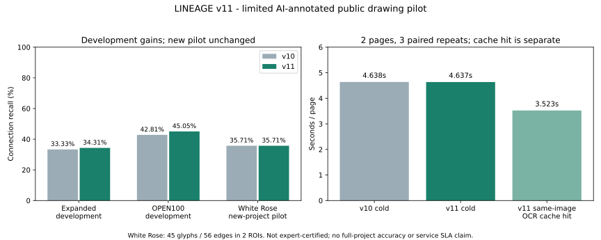

# v11 평가: 교정 데이터와 모델 예측의 분리

## 순서와 재현

`DEVELOPMENT.json`: 이미 평가했던 OPEN100 6–11, Winkler/Winnipeg 확장 영역은 **개발 데이터**로 명시 전환했다. `develop.py`에서 기존 타일 검출/OCR 결과를 고정하고 기존의 짧은 점선 복원을 켜는 단일 후보를 비교했다. 두 그룹의 합산 연결 재현율/F1이 하락하지 않고, 추가 정답 연결이 있으며, 추적 시간이 25% 이상 늘지 않으면 선택하는 기준이었다. 신경망 가중치 재학습은 하지 않았다.

선택 후 `white-rose-labels.json`과 `FROZEN-EXTRACTION.json`의 추출 코드/모델 해시를 고정했다. 새 자료에는 정답이나 영역 정보를 추출기에 넘기지 않고 전체 페이지를 처리했다. `evaluate.py`가 같은 입력으로 v10 Git 커밋과 v11을 3번씩 번갈아 실행해 결정성과 냉간 시간을 확인했다. v11은 매 냉간 실행 전 OCR 캐시를 비운다. 같은 이미지의 캐시 적중 시간은 별도로 측정했다. 주석 이후 새 평가 결과로 재조정하지 않았다.

실행: 제품 Python 환경에 requirements-dev.txt 설치 후 `OMP_NUM_THREADS=1 python evaluation/v11/develop.py`, 이후 `python evaluation/v11/evaluate.py`. 원본 PDF는 NEW-SOURCE.json의 공식 URL과 SHA256으로 확인하고 PDF 페이지 22/25를 폭 4800픽셀로 렌더링한다. 평가 환경 OCR 바이너리/언어 파일은 `evaluation/ocr_fingerprint.json`, OpenCV 스레드는 2다. 원본 파일/전체 OCR/소스 크롭은 Git과 컨테이너에서 제외한다. `develop.py`는 선택 시 topology-context.json을 변경하므로 과거 결과 재현은 해당 릴리스 소스와 동결 파일을 사용한다.

## 결과

| 평가군 | 정답 기호/연결 | 연결 재현율 v10→v11 | 연결 F1 v10→v11 |
|---|---:|---:|---:|
| 기존 확장 영역, 개발 | 78/102 | 33.33→34.31% | 35.98→36.84% |
| OPEN100 6–11, 개발 | 380/848 | 42.81→45.05% | 53.15→54.85% |
| White Rose 새 프로젝트 파일럿 | 45/56 | 35.71→35.71% | 46.51→46.51% |

OPEN1006에서 TP 66→65로 한 연결이 줄고, OPEN10011에서 FP 62→70으로 늘었다. 전체 합계의 향상이 모든 페이지의 향상을 뜻하지 않는다. 새 White Rose에서는 20 TP / 10 FP / 36 FN으로 동일했다. 기호는 28 TP / 4 FP / 17 FN: 재현율 62.22%, F1 72.73%. `HELD-OUT.json`에는 누락 원인과 페이지별 결과가 있다.

White Rose 2페이지의 페이지별 냉간 중앙값 평균은 4.638→4.637초로 사실상 같다. v11의 동일 이미지 OCR 캐시 적중은 3.523초로 약 24.0% 단축됐다. 새 도면의 냉간 처리 시간이 24% 빨라졌다는 의미가 아니다. 캐시는 이미지 해시·크기·OCR 엔진·언어·모드별 8개 단어 결과만 유지하며 입력 이미지 바이트는 저장하지 않는다. 변경된 픽셀에는 재사용되지 않는다. 단계별 `analysis_timing`도 API에 기록한다.

## 출처와 한계

[영국 정부 White Rose CCS Transport & Storage P&ID 기술 보고서](https://assets.publishing.service.gov.uk/media/5a758a57e5274a545822c4d8/K31_Transport__Storage_-_Piping_and_Instrumentation_Diagrams.pdf)의 Drax PIG Launcher(파일 페이지22), Tollingham Block Valve Station(25)의 지정 영역이다. 이 프로젝트는 가중치 학습과 후보 선택에 사용하지 않았다. 도면의 범례와 원본을 먼저 살펴 좌표를 측정한 **단일 AI 주석 파일럿**이며 전문가 인증이 없다. 2개 영역 45기호/56연결에 한정한 결과로 전체 도면·다른 도메인의 정확도를 보장하지 않는다. 밸브 몸체/계기 버블·패널을 대상으로 하고 일체형 구동부, 재료/피팅 태그, 관경 변화 등은 주석 명세에 따라 구분했다. 분기 접속은 중간 기호에서 멈추는 무방향 인접으로 평가한다. 정부 호스팅을 재배포 허가로 간주하지 않으며 원본은 저장소에 재배포하지 않는다.

## 제품 평가 기능

최초 예측은 분석 직후 별도 불변 레코드에 보존한다. 수동 수정본을 모델 예측으로 채점하지 않는다. 정답은 주석자·범위·근거·검토 버전과 함께 스냅샷으로 저장한다. 프로젝트 단위 분할은 정답 생성 후 잠기며, 동일 원본 SHA256/페이지/크기·동일 프로젝트의 최초 예측만 비교한다. 실제 모델 학습을 강제하는 도구가 아닌 데이터/평가 관리 기반이다. 이전 분석의 없는 최초 예측을 소급 생성하지 않는다.
