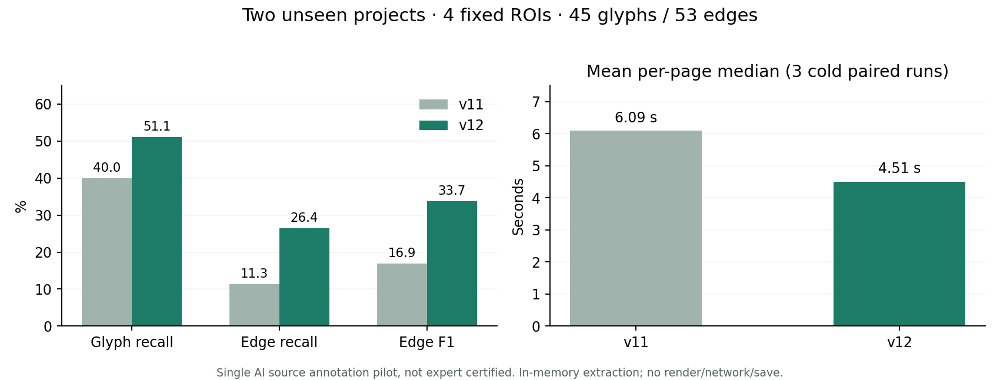

# v12 누락 기호 재학습·선택 재검출·검토 보정

비교 기준은 실제 v11 배포 `7e1c349c41c0bf92340d9c53d99629bb8bd4c8a3`의 전체 백엔드·모델입니다. v12는 누락 기호 재학습과 선택적 고해상도 재검출을 기본 추출에 적용하고, OCR 영역 분리와 범례·보정 검토 화면을 추가합니다. 공동 모델은 학습·평가했지만 기본 적용하지 않습니다. **LLM은 제안 구조·평가 준비만 완료했으며 외부 API 호출이나 실제 LLM 정확도 측정은 없습니다.**

## 새 프로젝트 평가

Peterhead CCS와 EPA/USACE Concord 정수처리시설의 실제 도면 4페이지에서 고정한 4개 영역, 기호 45개·연결 53개를 평가했습니다. 원본과 범례를 먼저 읽고 좌표·무시 영역·연결을 작성한 단일 AI 주석 파일럿입니다. 실무자 정답 인증, 전체 페이지 정확도, 대규모 통계 검증으로 해석할 수 없습니다. 연결은 방향 없는 시각적 인접 관계이며 물리적 유량·원인 관계가 아닙니다.

| 새 프로젝트 합계 | v11 | v12 |
|---|---:|---:|
| 기호 TP / FP / FN | 18 / 4 / 27 | 23 / 4 / 22 |
| 기호 정밀도 | 81.82% | 85.19% |
| 기호 재현율 / F1 | 40.00% / 53.73% | **51.11% / 63.89%** |
| 연결 TP / FP / FN | 6 / 12 / 47 | 14 / 16 / 39 |
| 연결 정밀도 | 33.33% | 46.67% |
| 연결 재현율 / F1 | 11.32% / 16.90% | **26.42% / 33.73%** |
| 페이지별 cold 중앙값의 평균 | 6.093초 | **4.506초, 26.0% 단축** |

| 영역 | 기호 재현율 v11→v12 | 연결 재현율 v11→v12 |
|---|---:|---:|
| Peterhead 17 | 44.44→55.56% | 10.00→30.00% |
| Peterhead 24 | 50.00→66.67% | **0.00→0.00%** |
| EPA 13 | 27.78→38.89% | 9.52→23.81% |
| EPA 15 | 50.00→58.33% | 17.65→35.29% |

동일한 최대 4800px 원본·2400px OCR/연결 입력으로 버전을 번갈아 3회 측정했습니다. 매번 OCR 캐시를 지웠으며 디코딩·PDF 렌더·네트워크·저장은 시간에 포함하지 않습니다. OpenCV 2스레드·OMP 1, 공유 CPU 호스트에서의 순차 비교로 운영 SLA나 동시 처리량은 아닙니다. 전체 수치는 [HELD-OUT.json](HELD-OUT.json), 사전 동결 해시는 [FROZEN-EXTRACTION.json](FROZEN-EXTRACTION.json)에 있습니다.

남은 연결 누락 39개 중 38개는 끝점 기호의 누락 또는 IoU 0.5 미달에 연관되고 1개는 두 끝점이 검출됐지만 경로 추적에 실패했습니다. 이는 원인 확정이 아닌 해당 평가 규칙의 분류입니다. 작은 밸브·모터 조작부·대형 장비의 경계와 주석 범위 차이를 추가로 다뤄야 합니다. Peterhead 24의 연결은 아직 복구되지 않았습니다.

## 단계별 구현과 선택 근거

1. **누락 중심 재학습**: 이전 White Rose 45개 기호를 이제 명시적으로 학습에 사용합니다. 이후 White Rose를 새로운 일반화 시험으로 주장하지 않습니다. 기존 replay 타일과 함께 학습하고 누락·경계 오차 기호에 가중치를 주었습니다. 초기 BN 통계를 함께 갱신한 후보는 OPEN100 4–5 검출 TP가 92→74/63으로 떨어져 탈락했습니다. BN 통계를 고정한 4 epoch 후보를 선정했습니다. [학습 기록](TRAINING-FROZEN-BN.json), [데이터 명세](TRAINING-DATA.json).
2. **선택적 고해상도 재검출**: 낮은 점수의 작은 기호와 독립 기하 후보를 384px 원본 크롭으로 재검출합니다. 신경망 제안이 전혀 없던 기호도 기하 후보가 재검출 위치를 제공할 수 있습니다. 최대 4개 추가 뷰, 전체 37개 뷰 예산 안에서 실행하며, 기존 검출과 겹친 추가 결과는 배제해 기존 박스가 교체되는 회귀를 방지했습니다. 단순히 임계값만 낮춘 후보와도 비교했습니다.
3. **OCR 영역 분리·병렬 처리**: 혼합 PDF는 네이티브 텍스트를 유지하고 큰 래스터 이미지 배치에만 OCR합니다. 작은 로고는 전체 OCR을 유발하지 않습니다. 같은 문자가 다른 위치에 반복되면 보존합니다. PNG/JPG·전체 스캔은 전체 OCR을 유지하며 기호 신경망과 OCR을 병렬 실행합니다. 사용자가 선택한 영역만 재인식해 별도 검토 후보로 저장할 수도 있습니다. floor/ceil 실제 크롭 픽셀 기준으로 좌표를 복원합니다.
4. **프로젝트 범례 인식**: 원본 기호 영역·프로젝트·의미 사전·버전·검토자를 저장합니다. 확인된 같은 프로젝트 범례만 5개 배율·4개 회전의 이진 마스크 IoU 검색에 사용합니다. 내부 문자를 제외하는 외곽 비교도 지원합니다. 점수는 보정된 확률이 아닙니다. 결과는 기호 추가 **제안**으로만 저장하고 검토자가 적용해야 합니다.
5. **공동 문맥 모델**: 실제 포트·접점 주석과 절차적으로 생성한 장면에서 7,181개 패치를 학습했습니다. 공유 CNN이 포트 2종·접점 4종·지역 선 종류 3종을 함께 예측하고 기존 경로 추적기의 점수와 혼합합니다. 그래프 전체를 학습하는 GNN은 아닙니다. [학습 로그](JOINT-TRAINING.json)와 ONNX를 저장했습니다. 기본값은 꺼져 있습니다.

## 기존 개발 영역과 회귀

아래 데이터는 이미 노출된 개발·보존 영역입니다. 후보 선정에 사용했으므로 새 프로젝트 성능과 구분합니다. [100회 조건별 실행](PIPELINE-VALIDATION.json), [이전 확대 영역 재채점](EXPANDED-PRESERVATION.json), [선택 기록](RELEASE-SELECTION.json).

| 개발 영역 | v11 연결 R / F1 | 재학습만 | 재학습+선택 재검출(선정) | +공동 0.25 | +공동 0.5 |
|---|---:|---:|---:|---:|---:|
| OPEN100 4–5 | 10.28 / 18.24% | 15.23 / 23.68% | **15.23 / 26.02%** | 15.23 / 25.62% | 15.23 / 25.30% |
| OPEN100 6–11 | 45.05 / 54.85% | 48.23 / 57.44% | **49.17 / 58.00%** | 47.64 / 56.58% | 47.29 / 56.24% |
| 기존 확대 78기호·102연결 | 34.31 / 36.84% | 36.27 / 37.00% | **36.27 / 37.00%** | 36.27 / 36.82% | 37.25 / 38.00% |
| Pāhala 개발 | 80.00 / 86.49% | 동일 | 동일 | 동일 | 동일 |
| 합성 개발 | 37.10 / 53.35% | 38.31 / 53.92% | 38.31 / 53.90% | 37.35 / 53.73% | 37.72 / 54.14% |

공동 모델은 일부 합성·확대 영역에서 FP를 줄이지만 OPEN100의 선정 추적기 대비 재현율이 떨어집니다. 소량 실제 접점, 특히 110개 T·162개 dot·74개 plain-X의 클래스 불균형과 지역 패치만으로 전역 경로를 판단하는 한계가 있습니다. 이 설명은 학습 명세에 근거한 가설이며 인과 실험으로 확인한 원인은 아닙니다. 따라서 실제 주석 보강 전 기본 적용을 보류했습니다. Winkler의 이전 작은 영역은 1개 연결이 감소했고 Pāhala·Winnipeg 기호 FP도 소폭 늘어 모든 도면의 개선을 보장하지 않습니다.

## 탈락한 OCR·범례 접근도 기록

문자 영역 atlas와 나머지 영역 마스킹 OCR은 기존 단어와의 일치율이 약 55–84%에 머물거나 오히려 느려 기본 적용하지 않았습니다. 기존 OCR과의 일치율은 실제 문자 정답 정확도가 아닙니다. [OCR 실험](OCR-SCREEN.json), [실험 구현](experimental_ocr.py). 네이티브 PDF의 원본 이미지 배치와 사용자가 지정한 ROI만 확실한 분리 기준으로 채택했습니다.

새 프로젝트의 별도 범례 페이지에서 고정한 3개 템플릿을 시험했습니다. 모든 범례 후보를 일괄 추가하고 경로를 다시 추론하는 별도 조건은 기호 재현율 51.11% 그대로, FP 4→10, 연결 재현율 26.42→13.21%로 악화했습니다. 배율·글꼴·선 겹침에 따른 오검출이 경로를 가릴 수 있으므로 **운영에서는 일괄 자동 적용·자동 재연결하지 않습니다.** [범례 출처·크롭 동결](LEGEND-SOURCES.json). 새 도면 정답 크롭을 템플릿으로 공급하지 않았습니다.

## 원본과 운영 검토 보존

`범례·보정` 탭에서 영역 재인식·범례 등록/확인·후보 검토·LLM 근거 내보내기와 제안 평가를 제공합니다. 제안을 적용해도 결과는 `needs_review`이며, 국제표준 식별자·물리적 접속을 자동 승인하지 않습니다. 이미지 해시·대상 서명·프로젝트·버전 충돌을 확인하고 작업 이력을 저장합니다. `analysis_runs`의 최초 예측과 원본 관찰 포트·경로는 변경하지 않습니다.

LLM 적용 경계와 재현 절차는 [LLM 보정 준비](LLM-CORRECTION.ko.md), [재현 안내](README.md)를 참조하세요. 운영 이미지·외부 업로드·저장 검증은 저장소 루트의 `DEPLOYED_V12_VERIFICATION.ko.md`에서 확인합니다.

## 공개 원문

- [영국 정부 Peterhead CCS Storage Documents](https://assets.publishing.service.gov.uk/media/5a7f295b40f0b6230268dd01/APPENDIX_5_11.003_Storage_Documents.pdf): 도면 PDF 17·24페이지, 범례 12페이지.
- [EPA/USACE Concord water treatment plant 도면](https://semspub.epa.gov/work/01/209087.pdf): PDF 13·15페이지, 범례 8페이지.

정부 사이트 게시가 재배포 허가를 뜻한다고 가정하지 않습니다. Git과 컨테이너에 원본 PDF·크롭·전체 OCR을 넣지 않았습니다. 정규화 주석·출처 해시·점수·자체 차트만 공개합니다.
