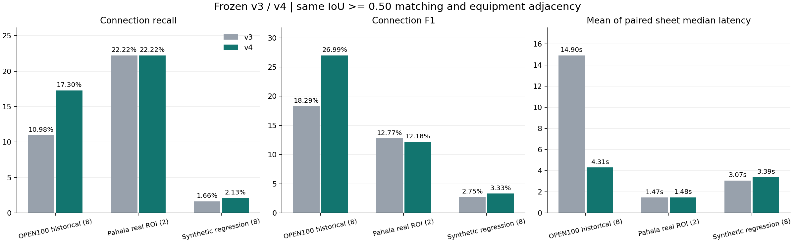
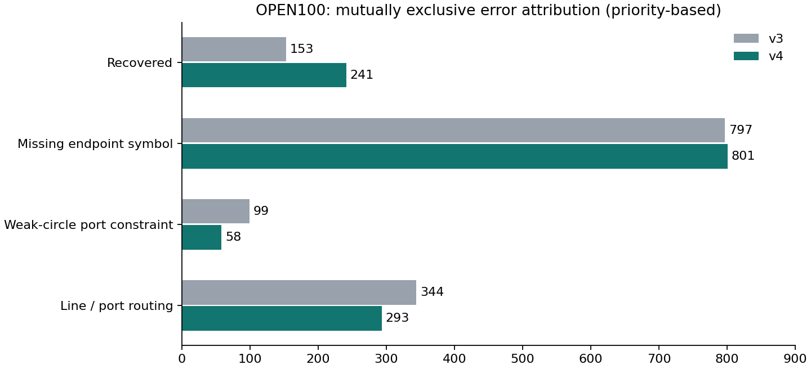

# v4 연결 누락 원인·재현율·속도 개선 평가

기준 앱 `2e111c42f33a02fb253b82a49e993c661e690ef3` → 개선 앱 `ab04ed8e529d8c605995cd5e8fbaa87b2b4ffeaf`. 평가 2026-10-28T06:11:52.803498+00:00. [CI](https://github.com/haesookimDev/lineage-drawings/actions/runs/40642672622).

기존 실제 OPEN100 8장의 연결 재현율은 **10.98%→17.30%**, 연결 F1은 **18.29%→26.99%**다. OCR+추출의 반복 측정 지연은 도면별 중앙값의 평균으로 **14.900초→4.308초**다.

## 같은 기준의 결과

| 평가 범위 | 버전 | 연결 P / R / F1 | 기호 위치 F1 | 도면별 중앙값 평균 |
|---|---|---|---:|---:|
| OPEN100 historical (8) | v3 | 54.64% / 10.98% / 18.29% | 74.04% | 14.900초 |
| OPEN100 historical (8) | v4 | 61.32% / 17.30% / 26.99% | 73.87% | 4.308초 |
| Pahala real ROI (2) | v3 | 8.96% / 22.22% / 12.77% | 46.85% | 1.468초 |
| Pahala real ROI (2) | v4 | 8.39% / 22.22% / 12.18% | 46.85% | 1.480초 |
| Synthetic regression (8) | v3 | 8.05% / 1.66% / 2.75% | 31.36% | 3.066초 |
| Synthetic regression (8) | v4 | 7.72% / 2.13% / 3.33% | 31.36% | 3.391초 |



## 다른 공개 실제 도면 검증

추가 원본은 [미국 EPA 공개 Pāhala WWTP 설계 문서](https://www.epa.gov/system/files/documents/2021-08/pahala-wwtp-design-build-drawings-2021-07-23.pdf)의 23쪽(P-601)·24쪽(P-602)다. OPEN100과 다른 Brown and Caldwell의 실제 프로젝트 설계 문서이며, 시공 완료 도면이나 운전 검증 문서라는 뜻은 아니다. 원본의 "general understanding of the project concept" 성격을 보존한다.

기호 48개·연결 54개를 포함하는 **사전 지정 공정 영역 두 곳만** 채점했다. 새 실제 영역의 연결 재현율은 22.22%→22.22%, F1은 12.77%→12.18%다. 전체 페이지를 PNG로 입력했으며 원본 PDF의 텍스트·벡터·주석은 모델에 주지 않았다.

정답은 원본을 보고 작성한 단일 시각 주석이다. 모델 예측을 보지 않고 영역·기호·관계를 먼저 기록했고 이후 변경하지 않았다. SCADA 버스의 모호한 의미와 23쪽 플로트 조립체는 사전 제외했다. [계획](PLAN.json), [주석](pahala-labels.json), [고정 시점·해시](FROZEN.json)에 범위가 있다. 해당 도면을 모델 학습·문턱값 조정에 쓰지 않았다. 공개 외부 기관의 인증된 전체 정답셋, 여러 새 프로젝트의 검증 또는 독립적인 전문가 이중 주석으로 표현하지 않는다. 원본 PDF·페이지 이미지·전체 OCR 문자는 저장소에 재배포하지 않는다.

| 새 실제 영역 | 기호 수 / 정답 연결 수 | v3 연결 TP / FP / FN | v4 연결 TP / FP / FN |
|---|---:|---|---|
| p23 | 12 / 11 | 1 / 51 / 10 | 1 / 60 / 10 |
| p24 | 36 / 43 | 11 / 71 / 32 | 11 / 71 / 32 |

## 누락 원인과 수정

기존 정답 연결 1,393개를 순서가 있는 진단으로 나누면 복구 153개, 끝점 기호 누락 797개, 검출됐지만 연결 자격이 꺼진 원형 후보 99개, 선·포트 추적 누락 344개였다. 독립적인 인과 비율은 아니며 누락 기호가 있으면 우선 해당 범주로 센다. 누락 끝점은 밸브 788회·탱크 119회·펌프 133회·계기 35회·연속 표지 10회로 반복 집계됐다. 서로 다른 누락 기호 개수와 다르다.

- 최소 선 검출 길이 12px→7px: 작은 기호 사이·계기 끝의 짧은 선을 더 보존한다.
- 포트 경계 2px 보정: 기호 윤곽과 선 중심의 작은 어긋남을 허용한다. 큰 간격을 임의로 연결하지 않는다.
- 약한 원형 후보: 실제 선 끝에서만 잎 노드로 붙인다. 통과하는 기존 선망을 끊는 장벽으로 사용하지 않는다.
- 일반 스타일: 기존 연결을 보존하고 짧은 선의 두 번째 추적으로 최대 100개를 보충한다. 총 상한은 500개이며 추가 FP가 생길 수 있다. 지원 스타일의 점/T자/무점 X 정책과 달리 일반 경로의 교차는 계속 검토가 필요하다.
- 템플릿 검색: 73개 개발 전용 자산을 바꾸지 않고, 반해상도 후보 탐색 후 원본 NCC 0.78 검증으로 전환한다. 근사 검색이라 일부 위치 검출은 달라진다.



최종 잔여 분류의 `disabled_symbol_port`는 호환성을 위한 필드명이다. v4에서는 완전히 끈 접점이 아니라 약한 원형 후보의 잎 접점 제약이 남은 경우를 뜻한다. 기호 누락이 여전히 가장 큰 원인이라 연결 완전성은 충분하지 않다.

## 부작용과 실패 결과

넓은 폐곡선·촘촘한 원형 후보를 추가한 시도는 오검출과 경로 차단을 늘려 폐기했다. [개발 중간 결과](iterations/short-lines-fast-search/report.json)를 보존했다. 새 포트 그래프를 일반 합성 스타일에 무조건 적용하는 시도도 F1이 약 2.75%→1.03%로 낮아져 채택하지 않았다. 일반 경로의 보충 방식만 채택했다. 이 합성 집합은 이전 작업에서 이미 보았으므로 새 보류셋이 아니다.

최종 합성 회귀 8장에서 연결 F1은 2.75%→3.33%지만 정밀도는 8.05%→7.72%다. 추가 FP의 비용도 함께 봐야 한다.

OPEN100의 위치 F1은 74.04%→73.87%로 소폭 낮아졌다. 정답 기호 영역을 준 연결 진단도 F1 58.53%→57.37%다. 이 진단은 실제 end-to-end 성능이 아니다. 전체 평균이 올라가도 도면별로 연결 재현율·F1이 내려가는 사례가 있다.

## 도면별 연결 결과

| 집합 / ID | v3 P / R / F1 | v4 P / R / F1 | v3→v4 중앙값 초 |
|---|---|---|---|
| open100 / 4 | 73.81% / 29.25% / 41.89% | 92.68% / 35.85% / 51.70% | 11.536→3.192 |
| open100 / 5 | 47.62% / 2.28% / 4.35% | 82.76% / 5.47% / 10.26% | 16.699→4.514 |
| open100 / 6 | 60.00% / 9.49% / 16.39% | 71.05% / 17.09% / 27.55% | 14.315→4.576 |
| open100 / 7 | 83.10% / 37.34% / 51.53% | 74.36% / 36.71% / 49.15% | 16.673→4.405 |
| open100 / 8 | 33.33% / 7.55% / 12.31% | 15.00% / 5.66% / 8.22% | 14.662→3.959 |
| open100 / 9 | 78.95% / 9.62% / 17.14% | 92.45% / 31.41% / 46.89% | 13.350→3.814 |
| open100 / 10 | 23.08% / 7.19% / 10.96% | 39.62% / 12.57% / 19.09% | 14.905→5.437 |
| open100 / 11 | 18.42% / 4.49% / 7.22% | 25.93% / 13.46% / 17.72% | 17.061→4.572 |
| pahala / p23 | 1.92% / 9.09% / 3.17% | 1.64% / 9.09% / 2.78% | 1.394→1.408 |
| pahala / p24 | 13.41% / 25.58% / 17.60% | 13.41% / 25.58% / 17.60% | 1.543→1.552 |
| synthetic / 9 | 7.48% / 1.05% / 1.84% | 6.16% / 1.18% / 1.98% | 2.821→2.838 |
| synthetic / 34 | 11.71% / 4.39% / 6.38% | 10.59% / 4.94% / 6.73% | 3.257→3.160 |
| synthetic / 385 | 3.45% / 0.55% / 0.95% | 6.67% / 1.93% / 3.00% | 2.962→2.897 |
| synthetic / 285 | 10.71% / 1.01% / 1.84% | 8.82% / 1.26% / 2.21% | 3.258→3.320 |
| synthetic / 317 | 15.38% / 3.31% / 5.44% | 13.70% / 4.13% / 6.35% | 3.007→3.112 |
| synthetic / 281 | 8.51% / 2.76% / 4.17% | 8.51% / 2.76% / 4.17% | 3.128→5.574 |
| synthetic / 82 | 2.59% / 0.26% / 0.48% | 3.95% / 0.62% / 1.06% | 2.815→2.825 |
| synthetic / 382 | 5.08% / 1.96% / 2.83% | 4.91% / 2.39% / 3.22% | 3.282→3.405 |

## 측정·재현·운영 반영

기준 v3의 전체 backend/모델은 Git 커밋으로 격리해 로드한다. 같은 클래스 무관 IoU 0.50 일대일 매칭과 무방향 장비 인접 관계를 썼다. 매칭 실패 끝점도 FP로 센다. 기존 OPEN100 8장은 역사적 회귀이며 이번에 독립적인 새 블라인드 결과가 된 것은 아니다. 73개 모델 자산의 학습 원본은 여전히 OPEN100 0–3뿐이다. 모든 자동 결과의 종류는 미분류, 상태는 검토 필요이며 국제표준 식별 성공률을 주장하지 않는다.

각 도면·버전을 순차로 3회씩 측정하고 반복마다 실행 순서를 뒤집었다. 18개 도면의 모든 반복에서 기호 영역·연결 쌍의 동일성도 검사했다. 지연은 이미지 디코딩·파일 전송·내보내기·정답 영역 진단을 제외한 OCR+추출 시간이다. 도면별 중앙값·최솟값·최댓값은 [CSV](per-sheet.csv), 모든 원시 실행 시간·수치·후보는 [결과](results/report.json)에 있다. 단일 CPU 호스트의 반복 측정으로 부하 시험이나 SLA를 대신하지 않는다.

로컬 전체 회귀 테스트 31개가 통과했고 CI 테스트·프런트 빌드도 확인했다. 실제 배포 결과와 외부 업로드·검토 저장 검증은 [운영 검증](../../DEPLOYED_V4_VERIFICATION.ko.md)에 기록한다. 앱 커밋은 문서 커밋과 구분하며 실행 Pod의 코드·모델 해시로 반영을 확인한다.

```bash
export PATH=/tmp/lineage-ocr-bookworm/bin:$PATH  # 또는 동일 버전 Tesseract 5.3.0 + eng/kor + TSV
export OMP_NUM_THREADS=1
.venv/bin/python scripts/fetch_public_benchmark.py
.venv/bin/python scripts/fetch_v3_confirmation.py
# Pahala 원본의 고정 SHA와 2400px 렌더링: fetch_pahala.py 참조
.venv/bin/python evaluation/v4/fetch_pahala.py
.venv/bin/python evaluation/v4/evaluate.py --group all --runs 3 --output evaluation/v4/results
.venv/bin/python evaluation/v4/render_report.py
```

공개 OPEN100/합성 원본·파생 결과는 기존 [NOTICE](../NOTICE.md)의 CC BY-SA 4.0을 따른다. Pāhala는 공공 웹에 공개된 제3자 설계 문서이며 별도 오픈 데이터 라이선스를 가정하지 않는다. 새 주석은 원본 사실을 수동 기록한 평가용 자료이며 원본·전체 OCR·이미지를 Git에 넣지 않았다.
