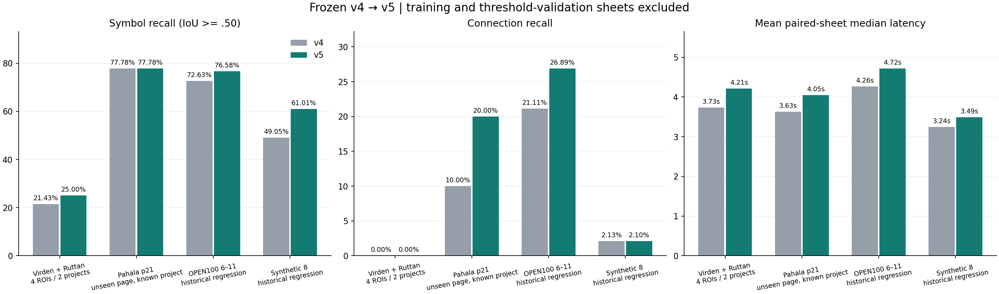
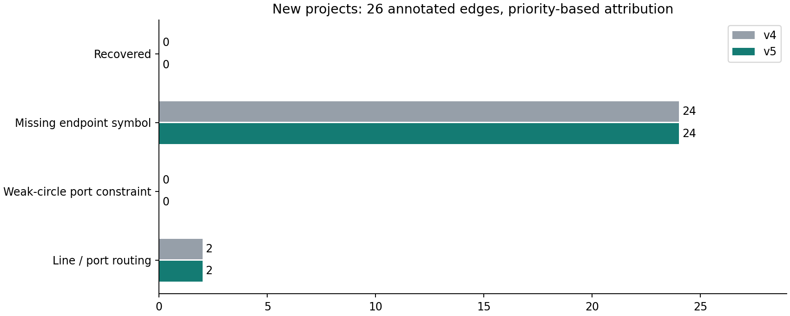

# v5 학습 기호 검출·새 프로젝트 검증

기준 앱 `ab04ed8e529d8c605995cd5e8fbaa87b2b4ffeaf` → 평가 고정 앱 `aef3ca96f8eb6d65ac7c3405b0be6c5da21ffa8b`. 실행 2026-10-28T07:56:19.200947+00:00. 문서 커밋은 실행 앱과 별개다.

학습·문턱값 선정에 쓰지 않은 Virden·Ruttan의 지정 영역 4곳에서 기호 재현율 **21.43%→25.00%**, 연결 재현율 **0.00%→0.00%**, 연결 F1 **0.00%→0.00%**를 측정했다. OCR+추출 지연은 **3.732→4.213초**다.

새 프로젝트 정답은 기호 28개·연결 26개다. 표본이 작고 Ruttan 두 장은 같은 플랜트의 상관된 개정본이다. 단일 작성자가 원본을 보고 영역·정답을 고정했다. 새 프로젝트의 원본 외관을 주석과 일반 전처리 설계에 참고했으므로, 독립된 전문가의 블라인드 검증이라고 표현하지 않는다. 전체 페이지 또는 일반 건축·전자회로 도면의 성능으로 확대 해석할 수 없다.

## 실제로 학습한 모델

CPU에서 32×32 HOG 324차원, foreground grid 64차원, 크기·종횡비·외부 선 문맥 7차원을 이용한 OpenCV Random Forest 객체성 검출기를 학습했다. 학습되지 않은 사전 규칙만 추가한 것은 아니지만, YOLO/Transformer 계열 신경망을 미세조정한 것도 아니다. 학습하는 것은 기호 영역과 배경의 구분이며, 국제표준 ID나 설비 종류를 학습했다고 주장하지 않는다.

선정 모델은 128개 트리, 최대 깊이 18, seed 20261028이다. OPEN100 0–3의 실제 도면 4장과 Pāhala 23·24쪽 영역, 합성 12장으로 1231개 정답 기호에서 **43,673개 파생 영역**(양성 9,343, 음성 34,330)을 만들었다. 565.233초 학습했으며 가중치 SHA-256은 `97d87e31e4f98d3e8eda112db81460cafc181ff7866c757a203d656542367e21`다. 파생 영역 수를 독립 도면 수로 계산하지 않는다.

첫 모델 R1과 회전·반전 증강을 포함한 두 번째 모델 R2를 실제로 학습했다. R2는 85,844개 파생 영역, 64개 트리, 561.826초였다. OPEN100 4·5, Pāhala20, 합성4장의 검증 세 출처에 대해 `mean(connection F1 + 0.25 × localization F1)`로 비교해 R1/추가 문턱값 0.8/기존 후보 제거 문턱값 0.3을 골랐다. R2는 선택되지 않았다. 최종 R1의 학습 증강은 정확 영역과 작은 위치·크기 변동이며 회전·반전 학습 결과가 최종 가중치에 포함됐다고 주장하지 않는다. [선정 기록](MODEL-SELECTION.json), [R1 학습 기록](TRAINING.json), [R2 학습 기록](iterations/TRAINING-r2.json)에 근거가 있다.

## 데이터 역할과 실제 출처

- **학습**: OPEN100 0–3, Pāhala23·24, PLAN의 새 합성12.
- **문턱값 검증**: OPEN1004·5, Pāhala20, 합성232·238·470·278.
- **새 프로젝트 평가**: [Virden 실제 P&ID](https://www.gov.mb.ca/sd/eal/registries/5697virden/2019-04-26_5697_00_phase_2_p_and_i_drwngs.pdf) 5·7쪽, [Ruttan 기술 제출 문서](https://gov.mb.ca/sd/eal/registries/294.30/20250618_letter.pdf) 50·62쪽. 모두 전체 페이지를 PNG로 입력하고 지정 영역만 채점했다. Virden은 스캔 기반, Ruttan은 옅은 벡터 선과 외곽선 글자 등 서로 다른 표현을 포함한다.
- **알려진 프로젝트의 미학습 페이지**: [Pāhala 개념설계](https://www.epa.gov/system/files/documents/2021-08/pahala-wwtp-design-build-drawings-2021-07-23.pdf) 21쪽. 프로젝트 독립 평가와 구분한다.
- **역사적 회귀**: OPEN1006–11, 이전 합성8. 이전 작업에서 사용했으므로 새 테스트라고 부르지 않는다.
- 원본 [PID2Graph](https://zenodo.org/records/14803338)는 기호 박스와 GraphML 연결을 제공한다. 실도면 ROI 주석에는 일반 equipment도 포함되며 위치 점수는 종류 무관이다.
- Salina·Haile PDF는 HTTP403으로 읽지 못해 사용하지 않았다. 새 프로젝트 추출 실행 전에 Virden·Ruttan으로 대체했다.

## 같은 기준의 결과

| 역할·범위 | 버전 | 기호 P / R / F1 | 연결 P / R / F1 | 도면별 중앙값 평균 |
|---|---|---|---|---:|
| new-projects | v4 | 23.08% / 21.43% / 22.22% | 0.00% / 0.00% / 0.00% | 3.732초 |
| new-projects | v5 | 35.00% / 25.00% / 29.17% | 0.00% / 0.00% / 0.00% | 4.213초 |
| pahala-unseen-page | v4 | 70.00% / 77.78% / 73.68% | 12.50% / 10.00% / 11.11% | 3.625초 |
| pahala-unseen-page | v5 | 70.00% / 77.78% / 73.68% | 40.00% / 20.00% / 26.67% | 4.046초 |
| open100-historical | v4 | 73.02% / 72.63% / 72.82% | 55.42% / 21.11% / 30.57% | 4.264초 |
| open100-historical | v5 | 69.45% / 76.58% / 72.84% | 59.69% / 26.89% / 37.07% | 4.718초 |
| pahala-training | v4 | 41.27% / 54.17% / 46.85% | 8.39% / 22.22% / 12.18% | 1.438초 |
| pahala-training | v5 | 66.04% / 72.92% / 69.31% | 26.19% / 40.74% / 31.88% | 1.881초 |
| synthetic-regression | v4 | 23.05% / 49.05% / 31.36% | 7.72% / 2.13% / 3.33% | 3.244초 |
| synthetic-regression | v5 | 30.53% / 61.01% / 40.69% | 7.37% / 2.10% / 3.26% | 3.489초 |

Pāhala23·24 행은 학습 진단이며 개선 일반화의 근거로 사용하지 않는다. 문턱값 검증 도면은 위 비교 그림에서 제외했다. 모든 개별 결과와 검증 도면 점수는 아래 표와 원시 JSON에 남겼다.



## 구현과 잔여 누락

기존 기하·형상 후보에 다중 크기 잉크 성분 및 큰 폐곡선 제안을 추가하고 학습된 객체성으로 선별한다. 기존 후보 중 낮은 점수의 배경 영역을 제거해 잘못된 영역이 선 추적을 차단하는 문제를 줄인다. 7,000개 제안·200개 최종 기호의 상한과 공간별 순회로 제목란의 빽빽한 글자가 제안 예산을 독점하지 않게 했다. 모델은 프로세스당 한 번만 로드하고 CPU 스레드는 2로 제한한다. 점수는 트리 투표 비율이며 보정된 확률이 아니다.

옅은 회색 선과 어두운 배경에 대응하도록 배경 반전과 국소 적응 이진화를 선 마스크·접속점 판별에 적용했다. 지원 스타일의 무점 X 비접속·점 교차·T 접속 규칙은 유지한다. 일반 스타일은 여전히 미확정 교차 후보다. 기존 연결 알고리즘 이름 `port-graph-v4`/`visible-components-v4`는 유지되며 새 `symbol_detector`와 `symbol_model_sha256` 진단 필드가 검출기를 식별한다.



누락 분류는 끝점 기호 누락→약한 원형 접점 제한→선/포트 추적 순서로 한 번만 집계한 진단이다. 독립적 인과 실험이 아니다. 정답 기호 박스를 주는 oracle 진단은 실제 종단 성능이 아니며 원시 JSON에만 별도 기록했다. 학습 검출기가 펌프·밸브를 모두 해결한 것은 아니고, 글자·해칭·복잡한 조립체의 오검출과 기호 영역 중복, 얇은 선 단절이 남는다. 자동 영향 분석의 확정 그래프로 사용하기에는 재현율이 부족해 모든 후보를 검토 필요로 유지한다.

## 도면별 결과와 속도 비용

| 집합 / ID / 역할 | v4 연결 P / R / F1 | v5 연결 P / R / F1 | v4→v5 중앙값 초 |
|---|---|---|---|
| open100 / 4 / threshold-validation | 92.68% / 35.85% / 51.70% | 91.23% / 49.06% / 63.80% | 3.138→3.564 |
| open100 / 5 / threshold-validation | 82.76% / 5.47% / 10.26% | 56.76% / 4.78% / 8.82% | 4.396→4.865 |
| open100 / 6 / historical-regression | 71.05% / 17.09% / 27.55% | 44.90% / 13.92% / 21.26% | 4.409→4.902 |
| open100 / 7 / historical-regression | 74.36% / 36.71% / 49.15% | 73.44% / 29.75% / 42.34% | 4.291→4.759 |
| open100 / 8 / historical-regression | 15.00% / 5.66% / 8.22% | 19.35% / 11.32% / 14.29% | 3.778→4.185 |
| open100 / 9 / historical-regression | 92.45% / 31.41% / 46.89% | 95.80% / 73.08% / 82.91% | 3.680→4.128 |
| open100 / 10 / historical-regression | 39.62% / 12.57% / 19.09% | 51.22% / 12.57% / 20.19% | 5.276→5.770 |
| open100 / 11 / historical-regression | 25.93% / 13.46% / 17.72% | 23.08% / 11.54% / 15.38% | 4.152→4.564 |
| pahala-training / p23 / training-diagnostic | 1.64% / 9.09% / 2.78% | 37.50% / 54.55% / 44.44% | 1.347→1.788 |
| pahala-training / p24 / training-diagnostic | 13.41% / 25.58% / 17.60% | 23.53% / 37.21% / 28.83% | 1.528→1.974 |
| pahala-validation / p20 / threshold-validation | 0.00% / 0.00% / 0.00% | 0.00% / 0.00% / 0.00% | 0.917→1.284 |
| pahala-unseen-page / p21 / unseen-page-known-project | 12.50% / 10.00% / 11.11% | 40.00% / 20.00% / 26.67% | 3.625→4.046 |
| virden / p5 / unseen-project | 0.00% / 0.00% / 0.00% | 0.00% / 0.00% / 0.00% | 2.320→2.802 |
| virden / p7 / unseen-project | 0.00% / 0.00% / 0.00% | 0.00% / 0.00% / 0.00% | 2.252→2.692 |
| ruttan / p50 / unseen-project-revision-pair | 0.00% / 0.00% / 0.00% | 0.00% / 0.00% / 0.00% | 3.421→3.899 |
| ruttan / p62 / unseen-project-revision-pair | 0.00% / 0.00% / 0.00% | 0.00% / 0.00% / 0.00% | 6.936→7.458 |
| synthetic-validation / 232 / threshold-validation | 0.70% / 0.17% / 0.28% | 4.32% / 0.70% / 1.20% | 2.979→3.424 |
| synthetic-validation / 238 / threshold-validation | 8.45% / 3.70% / 5.15% | 13.18% / 4.30% / 6.48% | 3.095→3.555 |
| synthetic-validation / 470 / threshold-validation | 12.32% / 4.24% / 6.31% | 8.47% / 3.12% / 4.56% | 3.044→3.507 |
| synthetic-validation / 278 / threshold-validation | 3.07% / 0.83% / 1.31% | 12.34% / 4.82% / 6.93% | 5.066→3.751 |
| synthetic-regression / 9 / historical-regression | 6.16% / 1.18% / 1.98% | 4.08% / 0.79% / 1.32% | 2.771→3.223 |
| synthetic-regression / 34 / historical-regression | 10.59% / 4.94% / 6.73% | 3.40% / 1.83% / 2.38% | 3.040→3.506 |
| synthetic-regression / 385 / historical-regression | 6.67% / 1.93% / 3.00% | 3.54% / 0.97% / 1.52% | 2.751→3.228 |
| synthetic-regression / 285 / historical-regression | 8.82% / 1.26% / 2.21% | 6.05% / 1.43% / 2.31% | 3.236→3.717 |
| synthetic-regression / 317 / historical-regression | 13.70% / 4.13% / 6.35% | 21.74% / 4.82% / 7.89% | 3.058→3.551 |
| synthetic-regression / 281 / historical-regression | 8.51% / 2.76% / 4.17% | 11.52% / 4.31% / 6.27% | 4.953→3.529 |
| synthetic-regression / 82 / historical-regression | 3.95% / 0.62% / 1.06% | 4.00% / 0.44% / 0.79% | 2.788→3.289 |
| synthetic-regression / 382 / historical-regression | 4.91% / 2.39% / 3.22% | 7.35% / 3.59% / 4.82% | 3.351→3.873 |

학습 검출기에는 추가 계산 비용이 있어 전체 지연이 단축됐다고 일괄 주장하지 않는다. 그림·표의 실제 측정값과 개별 악화 사례를 함께 판단해야 한다. 도면별 3회, 순서를 번갈아 순차 측정했고 모든 반복에서 박스·연결 쌍이 동일함을 검사했다. 입력은 최대 2400px RGB이며 OCR+기호+선+연결 추론만 측정한다. 전송·디코딩·원본 PDF 렌더링·내보내기·oracle 계산은 제외한다. 단일 호스트 결과이며 동시 작업 처리량이나 SLA가 아니다. [CSV](per-sheet.csv), [실행 결과](results/report.json)에 168회 추론의 시간과 수치를 보존했다.

## 재현과 운영 반영

```bash
.venv/bin/python scripts/fetch_public_benchmark.py
.venv/bin/python scripts/fetch_v3_confirmation.py
.venv/bin/python evaluation/v5/fetch_data.py
# 재학습은 backend/assets를 덮어쓰므로 별도 checkout에서 실행
.venv/bin/python evaluation/v5/train.py --variant original
# R2 실험: --variant augmented; 배포 모델로 자동 선정하지 않음
export PATH=/tmp/lineage-ocr-bookworm/bin:$PATH  # 동일 Tesseract5.3.0/eng/kor/TSV
export OMP_NUM_THREADS=1
.venv/bin/python evaluation/v5/evaluate.py --runs 3
.venv/bin/python evaluation/v5/render_report.py
```

정확한 평가 해시는 [FROZEN](FROZEN.json), 소스 PDF·페이지 해시는 [실도면 출처](real-sources.json)와 [주석](real-labels.json), 가중치와 학습 해시는 [모델 카드](MODEL-CARD.ko.md)에 있다. 재학습 XML 직렬화는 라이브러리·병렬 실행 환경에 따라 바이트가 달라질 수 있으므로 평가에는 제공된 고정 가중치를 사용한다. 전체 회귀 테스트 35개를 통과했다. 실제 배포·외부 로그인·업로드·검토 저장·Pod 해시는 [운영 검증](../../DEPLOYED_V5_VERIFICATION.ko.md)에 기록한다.

정부 웹사이트에 공개된 제3자 설계 문서에 별도 공개 재배포 권한을 가정하지 않는다. 원본 PDF·페이지 이미지·전체 OCR은 Git/Docker 컨텍스트에서 제외했다. 자체 생성 통계 그림과 기하 주석만 게시한다. PID2Graph 유래 가중치·파생 데이터의 출처 및 CC BY-SA4.0은 [NOTICE](../../backend/assets/NOTICE.md)를 따른다.


## 고정 평가 후 누락 단계 감사

예측을 본 뒤 실행한 [단계 감사](post-freeze-symbol-audit.json)는 모델 수정·문턱값 재선정에 사용하지 않았다. 새 프로젝트 기호 28개 중 **13개는 IoU0.50에 도달하는 제안 자체가 없었고**, 다른 **9개는 해당 제안이 있어도 학습 객체성 점수0.8 미만**이었다. 기존 기하 후보·중복 제거 경로도 있어 두 숫자의 나머지를 최종 TP로 간주할 수 없다. 펌프 조립체의 한 부분만 둘러싸거나 작은 밸브의 폭·높이가 한두 픽셀 어긋나는 제안 누락과, 학습 출처 밖 기호를 배경으로 판단하는 분포 차이가 함께 남았다. 박스 정답을 준 Virden7의 연결 재현율은100%였지만 실제 검출을 포함하면0%여서, 그 영역은 연결기보다 끝점 기호 검출이 우선 병목이다. 이 oracle 값을 실제 정확도로 보고하지 않았다.

이번 배포의 개선은 OPEN100 회귀·Pāhala 미학습 페이지와 일부 새 기호 보강에서 확인되며, **새 프로젝트 연결 추출 문제를 해결한 버전은 아니다**. 합성 회귀의 연결 F1은3.33%→3.26%로 소폭 하락했다. 앞으로의 학습에는 다양한 실도면 펌프·작은 밸브의 정답을 확충하고, 제안 누락을 줄이는 고해상도 타일 검출기를 별도로 비교해야 한다.
