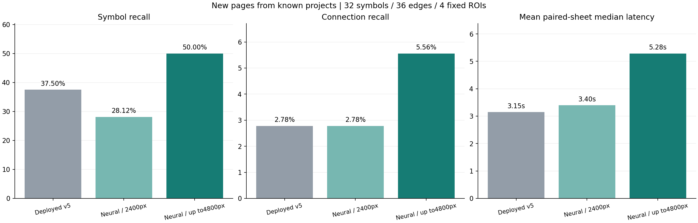
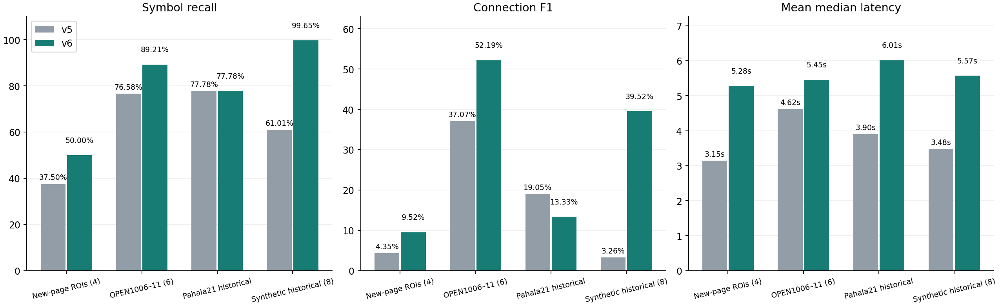

# v6 고해상도 타일·신경망 검출 개발 및 평가

기준 앱 `aef3ca96f8eb6d65ac7c3405b0be6c5da21ffa8b` → 개선 앱 `844bf3b03ce34de575509bf66b531aca83ffba0d`. 평가 2026-10-28T08:48:00.849198+00:00. 실행 앱과 이후 보고서 커밋은 구분한다.

새 페이지4곳의 지정 영역에서 기호 재현율은 **37.50%→50.00%**, 연결 재현율은 **2.78%→5.56%**, 연결 F1은 **4.35%→9.52%**다. OCR+추출 지연은 **3.146→5.283초**다.

기호32개·연결36개의 작은 평가다. **새 페이지는 학습한 프로젝트에 속하며 새 프로젝트 일반화 검증이 아니다.** Virden6·8, Pāhala22, Ruttan51의 영역·정답을 새 모델 예측 전에 시각적으로 고정했다. 단일 주석자이며 독립 전문가 정답셋이나 전체 페이지 정확도로 표현하지 않는다. 원본 외관은 주석에 사용했고 정답 수정 두 건(Pāhala 출력 화살표 y 위치)은 첫 예측 전에 완료했다. [정답 고정 기록](LABELS-FROZEN.json), [주석 범위](new-page-labels.json).

## 실제 구현과 학습

- 기존 HOG/Random Forest 후보 분류에 더해 **YOLOX-Nano 직접 검출기**를 학습했다. COCO 사전학습 초기값에서 일반 기호1개 클래스로 머리를 교체해 전체 층을 미세조정했다. 의미·표준 식별 모델은 아니다.
- 학습 원천은 OPEN1000–3/Pāhala23·24/Virden5·7/Ruttan50·62의 실제10장·영역(4프로젝트), 이전 합성12장이다. 원천 정답1,259개에서607개 학습 타일을 만들었다. 원천 정답 수·타일 수·중복 샘플링 횟수를 독립 도면 수로 세지 않는다. v5에서 테스트했던 Virden/Ruttan 영역은 이제 학습 자료이며 이번 성능에서 보류셋으로 보고하지 않는다.
- 부분 주석 실도면은 주석된 ROI 안에서만 학습해 바깥의 미주석 기호를 음성 정답으로 쓰지 않았다. 학습 전용 좌우 반전·대비/밝기·약한 흐림을 적용했다. Pāhala/Virden/Ruttan 타일의 상대 추출 가중치는2.5이며 중복 추출한다.

CPU4스레드·배치4·단계당96배치·24개 학습 단계로 총9,216개 타일 샘플을 추출해 학습했다. 전체 학습은 **853.397초**였다. 8/16/24 체크포인트를 별도 검증7장으로 비교해 **16단계·점수0.6·신경망 후보 사용(neural_only)**을 선정했다. 마지막24단계는 검증 목적함수가 낮아 채택하지 않았다. [학습 기록](TRAINING.json), [선정 기록](MODEL-SELECTION.json).

- 타일은 최대4800px 원본에서1024px, 20%중첩으로 만들고 모델 입력640px로 변환한다. 최대36개 타일과 전체 페이지1개로 작은 기호와 큰 장비를 함께 탐색한다. 겹친 박스는 IoU0.4 억제로 합친다. 최종 기호200개·전체 요소500개 상한은 유지한다.
- 미리보기·OCR·선 추적 좌표는2400px로 유지한다. PNG/JPG는 원본을 보존해 별도 고해상도 입력을 만들고, PDF는 별도로 고해상도 렌더링한다. 타일 결과는 정규화 좌표로 합친다. DXF 원본 블록·문자 경로는 기존대로 처리한다.
- 배포는 ONNX를 기존 OpenCV DNN CPU로 실행한다. PyTorch와 학습 도구는 운영 이미지에 추가하지 않았다. 체크포인트 ONNX와 PyTorch의 흰색 시험 입력 수치 차이를 검사했고, 운영 함수가 선택 검증 결과와 일치하는지도 OPEN1004·Pāhala20에서 대조했다. 상세 차이는 모델 메타데이터에 있다.
- 선정된 neural_only 경로에서는 사용하지 않는 HOG 분류·추가 검출을 생략한다. 기존 형상 분석은 연결 추적 스타일 결정에 남아 있다. 점수는 보정된 확률이 아니며 모든 후보의 종류unknown/상태needs_review를 유지한다.

## 해상도 비교

동일한 선정 모델에2400px 미리보기만 입력하는 `v6-preview`도 새4페이지에서3회씩 비교했다. 이 비교는 해상도·타일 수를 바꾸며, v5→v6 비교는 데이터 확장과 검출기 교체까지 함께 바꾸므로 모델 효과만의 인과 실험으로 보지 않는다.

| 새 페이지 지정 영역 | 기호 P / R / F1 | 연결 P / R / F1 | 지연 |
|---|---|---|---:|
| v5 | 57.14% / 37.50% / 45.28% | 10.00% / 2.78% / 4.35% | 3.146초 |
| v6-preview | 64.29% / 28.12% / 39.13% | 50.00% / 2.78% / 5.26% | 3.399초 |
| v6 | 66.67% / 50.00% / 57.14% | 33.33% / 5.56% / 9.52% | 5.283초 |



## 회귀 결과

| 평가 범위 | 버전 | 기호 P / R / F1 | 연결 P / R / F1 | 지연 |
|---|---|---|---|---:|
| new-page | v5 | 57.14% / 37.50% / 45.28% | 10.00% / 2.78% / 4.35% | 3.146초 |
| new-page | v6 | 66.67% / 50.00% / 57.14% | 33.33% / 5.56% / 9.52% | 5.283초 |
| open100-regression | v5 | 69.45% / 76.58% / 72.84% | 59.69% / 26.89% / 37.07% | 4.617초 |
| open100-regression | v6 | 97.98% / 89.21% / 93.39% | 75.17% / 39.98% / 52.19% | 5.453초 |
| pahala-p21-regression | v5 | 77.78% / 77.78% / 77.78% | 18.18% / 20.00% / 19.05% | 3.905초 |
| pahala-p21-regression | v6 | 87.50% / 77.78% / 82.35% | 20.00% / 10.00% / 13.33% | 6.015초 |
| synthetic-regression | v5 | 30.53% / 61.01% / 40.69% | 7.37% / 2.10% / 3.26% | 3.482초 |
| synthetic-regression | v6 | 92.44% / 99.65% / 95.91% | 88.81% / 25.42% / 39.52% | 5.572초 |



OPEN1006–11·Pāhala21·합성8은 이전에 평가한 역사적 회귀다. 실제 프로젝트 PNG는 이번에 같은 원본의4800px 렌더를 양쪽 버전에 입력했다. 과거2400px 직접 렌더 PNG와 바이트가 달라 일부 기준 점수도 이전 보고서와 다르며, 이번 동일 입력의 짝 비교 수치를 따른다. 새 평가와 합쳐 새 프로젝트 성능으로 표현하지 않는다. 기호 IoU0.50 최대 일대일 매칭 및 첫 장비 무방향 인접 관계를 유지하며, 미매칭 끝점 연결도 FP로 센다. 판별된 종류 정확도나 국제표준 식별률은 주장하지 않는다.

## 실패 사례와 남은 한계

새 Virden6에서 기호를 더 찾았지만 정답 연결은 복구하지 못했다. Virden8은 연결을 일부 추가 복구했다. Pāhala22의 기호 재현율은 기존보다 낮아졌고, Ruttan51도 연결 TP가 없었다. 학습한 프로젝트의 새 페이지에서도 복합 밸브·펌프·작은 기호와 바운딩 박스의 범위 차이에 취약하다. 성능을 모든 도면에서 향상시켰다고 표현하지 않는다.

기호 검출 개선이 연결로 그대로 이어지지 않았다. 포트 위치, 기호 내부를 통과하는 선, 짧은 선 단절과 교차 관례가 다음 병목이다. 이번 범위는 데이터 확장과 타일 신경망 검출까지이며, 포트·접점 신경망 및 Relationformer 공동학습을 구현·평가했다고 주장하지 않는다. 이들은 후속 비교 대상이다. 기존 X/점/T 접속 규칙을 유지하며, 온톨로지·VLM으로 보이지 않는 관계를 정답처럼 생성하지 않았다.

## 도면별 결과

| 집합 / ID | 버전 | 기호 TP / FP / FN | 연결 TP / FP / FN | 연결 P / R / F1 | 중앙값 초 |
|---|---|---|---|---|---:|
| new-page / virden-p6 | v5 | 3 / 5 / 6 | 0 / 4 / 10 | 0.00% / 0.00% / 0.00% | 2.821 |
| new-page / virden-p6 | v6-preview | 6 / 2 / 3 | 0 / 0 / 10 | 0.00% / 0.00% / 0.00% | 3.076 |
| new-page / virden-p6 | v6 | 7 / 4 / 2 | 0 / 0 / 10 | 0.00% / 0.00% / 0.00% | 4.964 |
| new-page / virden-p8 | v5 | 2 / 3 / 4 | 1 / 5 / 5 | 16.67% / 16.67% / 16.67% | 2.122 |
| new-page / virden-p8 | v6-preview | 2 / 1 / 4 | 1 / 1 / 5 | 50.00% / 16.67% / 25.00% | 2.372 |
| new-page / virden-p8 | v6 | 3 / 3 / 3 | 2 / 3 / 4 | 40.00% / 33.33% / 36.36% | 4.268 |
| new-page / pahala-p22 | v5 | 5 / 0 / 4 | 0 / 0 / 14 | 0.00% / 0.00% / 0.00% | 4.080 |
| new-page / pahala-p22 | v6-preview | 1 / 2 / 8 | 0 / 0 / 14 | 0.00% / 0.00% / 0.00% | 4.326 |
| new-page / pahala-p22 | v6 | 4 / 1 / 5 | 0 / 1 / 14 | 0.00% / 0.00% / 0.00% | 6.184 |
| new-page / ruttan-p51 | v5 | 2 / 1 / 6 | 0 / 0 / 6 | 0.00% / 0.00% / 0.00% | 3.561 |
| new-page / ruttan-p51 | v6-preview | 0 / 0 / 8 | 0 / 0 / 6 | 0.00% / 0.00% / 0.00% | 3.823 |
| new-page / ruttan-p51 | v6 | 2 / 0 / 6 | 0 / 0 / 6 | 0.00% / 0.00% / 0.00% | 5.717 |
| open100-regression / 6 | v5 | 60 / 20 / 10 | 22 / 27 / 136 | 44.90% / 13.92% / 21.26% | 4.870 |
| open100-regression / 6 | v6 | 69 / 0 / 1 | 40 / 17 / 118 | 70.18% / 25.32% / 37.21% | 5.716 |
| open100-regression / 7 | v5 | 51 / 23 / 10 | 47 / 17 / 111 | 73.44% / 29.75% / 42.34% | 4.686 |
| open100-regression / 7 | v6 | 57 / 1 / 4 | 64 / 13 / 94 | 83.12% / 40.51% / 54.47% | 5.486 |
| open100-regression / 8 | v5 | 25 / 12 / 11 | 6 / 25 / 47 | 19.35% / 11.32% / 14.29% | 4.072 |
| open100-regression / 8 | v6 | 36 / 1 / 0 | 38 / 11 / 15 | 77.55% / 71.70% / 74.51% | 4.957 |
| open100-regression / 9 | v5 | 35 / 19 / 7 | 114 / 5 / 42 | 95.80% / 73.08% / 82.91% | 3.999 |
| open100-regression / 9 | v6 | 36 / 1 / 6 | 129 / 0 / 27 | 100.00% / 82.69% / 90.53% | 4.828 |
| open100-regression / 10 | v5 | 62 / 30 / 27 | 21 / 20 / 146 | 51.22% / 12.57% / 20.19% | 5.593 |
| open100-regression / 10 | v6 | 77 / 3 / 12 | 40 / 37 / 127 | 51.95% / 23.95% / 32.79% | 6.418 |
| open100-regression / 11 | v5 | 58 / 24 / 24 | 18 / 60 / 138 | 23.08% / 11.54% / 15.38% | 4.482 |
| open100-regression / 11 | v6 | 64 / 1 / 18 | 28 / 34 / 128 | 45.16% / 17.95% / 25.69% | 5.313 |
| pahala-p21-regression / p21 | v5 | 7 / 2 / 2 | 2 / 9 / 8 | 18.18% / 20.00% / 19.05% | 3.905 |
| pahala-p21-regression / p21 | v6 | 7 / 1 / 2 | 1 / 4 / 9 | 20.00% / 10.00% / 13.33% | 6.015 |
| synthetic-regression / 9 | v5 | 37 / 99 / 29 | 6 / 141 / 757 | 4.08% / 0.79% / 1.32% | 3.240 |
| synthetic-regression / 9 | v6 | 66 / 13 / 0 | 137 / 59 / 626 | 69.90% / 17.96% / 28.57% | 5.305 |
| synthetic-regression / 34 | v5 | 46 / 103 / 26 | 10 / 284 / 537 | 3.40% / 1.83% / 2.38% | 3.506 |
| synthetic-regression / 34 | v6 | 72 / 2 / 0 | 167 / 9 / 380 | 94.89% / 30.53% / 46.20% | 5.575 |
| synthetic-regression / 385 | v5 | 33 / 116 / 31 | 7 / 191 / 717 | 3.54% / 0.97% / 1.52% | 3.207 |
| synthetic-regression / 385 | v6 | 64 / 15 / 0 | 194 / 64 / 530 | 75.19% / 26.80% / 39.51% | 5.296 |
| synthetic-regression / 285 | v5 | 45 / 89 / 23 | 17 / 264 / 1172 | 6.05% / 1.43% / 2.31% | 3.714 |
| synthetic-regression / 285 | v6 | 68 / 2 / 0 | 139 / 12 / 1050 | 92.05% / 11.69% / 20.75% | 5.832 |
| synthetic-regression / 317 | v5 | 47 / 89 / 31 | 35 / 126 / 691 | 21.74% / 4.82% / 7.89% | 3.559 |
| synthetic-regression / 317 | v6 | 78 / 2 / 0 | 314 / 24 / 412 | 92.90% / 43.25% / 59.02% | 5.669 |
| synthetic-regression / 281 | v5 | 41 / 109 / 24 | 25 / 192 / 555 | 11.52% / 4.31% / 6.27% | 3.525 |
| synthetic-regression / 281 | v6 | 65 / 6 / 0 | 216 / 23 / 364 | 90.38% / 37.24% / 52.75% | 5.631 |
| synthetic-regression / 82 | v5 | 38 / 88 / 28 | 5 / 120 / 1133 | 4.00% / 0.44% / 0.79% | 3.247 |
| synthetic-regression / 82 | v6 | 66 / 7 / 0 | 134 / 20 / 1004 | 87.01% / 11.78% / 20.74% | 5.356 |
| synthetic-regression / 382 | v5 | 65 / 108 / 33 | 33 / 416 / 886 | 7.35% / 3.59% / 4.82% | 3.857 |
| synthetic-regression / 382 | v6 | 96 / 0 / 2 | 373 / 0 / 546 | 100.00% / 40.59% / 57.74% | 5.915 |

## 재현·측정 범위

각 도면·버전3회, 반복마다 순서를 뒤집어 순차 측정했다. 총126회 추론의 모든 반복에서 박스와 연결 쌍이 동일함을 확인했다. 지연은 OCR·기호·선·연결 추론이며, 파일 전송·RGB 디코딩·축소·PDF 렌더링을 제외한다. 고해상도 처리로 계산이 늘었으며 속도가 일괄 개선됐다고 주장하지 않는다. 운영 파일 업로드 전체 시간은 별도로 [운영 검증](../../DEPLOYED_V6_VERIFICATION.ko.md)에 기록한다.

```bash
# Python3.12; ML dependencies isolated from runtime
.venv-ml/bin/python evaluation/v6/train.py
.venv-ml/bin/python evaluation/v6/export.py --epoch 16
# Provided immutable runtime assets recommended for exact evaluation
export PATH=/tmp/lineage-ocr-bookworm/bin:$PATH
export OMP_NUM_THREADS=1
.venv/bin/python evaluation/v6/evaluate.py
.venv/bin/python evaluation/v6/render_report.py
```

원본은 [PID2Graph](https://zenodo.org/records/14803338), [Pāhala](https://www.epa.gov/system/files/documents/2021-08/pahala-wwtp-design-build-drawings-2021-07-23.pdf), [Virden](https://www.gov.mb.ca/sd/eal/registries/5697virden/2019-04-26_5697_00_phase_2_p_and_i_drwngs.pdf), [Ruttan](https://gov.mb.ca/sd/eal/registries/294.30/20250618_letter.pdf)이다. 실제 원본 PDF·페이지·타일·전체 OCR은 Git과 Docker 컨텍스트에서 제외한다. 도면 접근 가능성이 공개 재배포 라이선스를 뜻하지 않는다. [출처·가중치 NOTICE](../../backend/assets/NOTICE.md), [모델 카드](MODEL-CARD.ko.md), [재현 안내](REPRODUCE.ko.md), [고정 해시](FROZEN.json), [CSV](per-sheet.csv), [원시 결과](results/report.json)를 제공한다.
