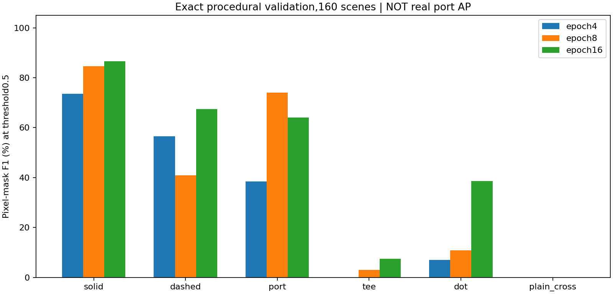
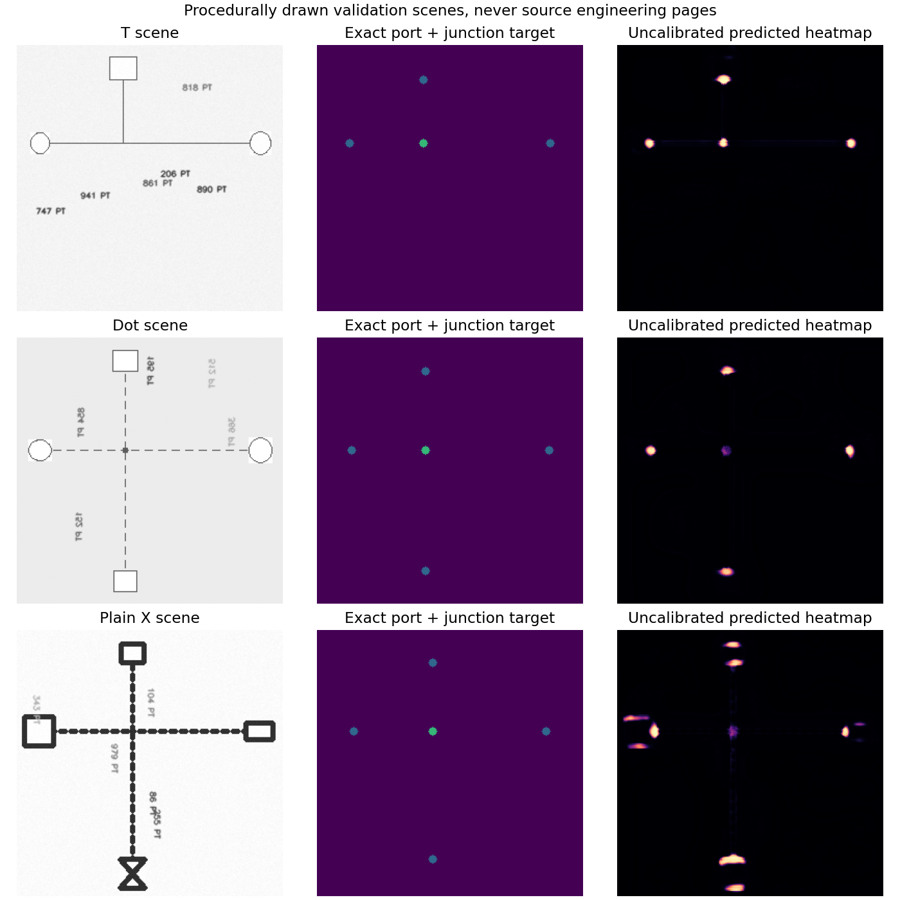
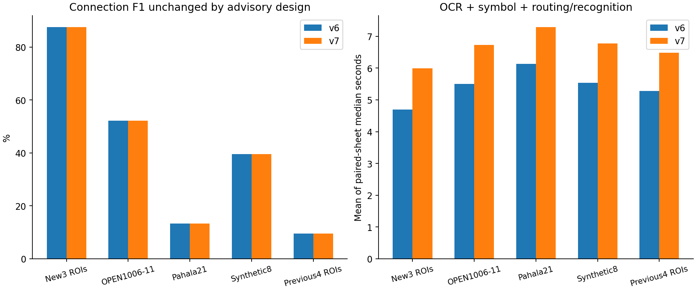

# 선·포트·접속점 인식 v7 평가

**구현 범위:** 실선/점선·기호 포트·접속/교차 후보를 인식하고 관찰 경로를 저장·표시한다. **배포 연결 판정은 v6 그대로 유지한다.** 새로운 추적기로 대체하거나 합집합을 만들면 검증 오연결이 늘어 채택하지 않았다. 연결 재현율 개선으로 발표하지 않는다.

## 배포한 기능

- 6채널 소형 U-Net + 실제 잉크·기하학 검증. CPU OpenCV ONNX, 기호 YOLOX-Nano는 고정.
- 요소 속성에 포트 좌표·변·점수·검토 필요 상태, 페이지에 선 종류·접점/교차·관찰 경로를 저장한다.
- 뷰어의 선·포트·접점 토글과 포트 목록. 기존 연결과 일치하는 관찰 경로는 중심선 대신 꺾인 경로로 표시한다.
- 요소 영역 변경 시 이전 포트/경로 표시를 숨긴다. 기존 JSON 저장 구조와 내보내기를 유지한다.
- 후보는 자동 승인하지 않는다. 요소/연결 승인이 포트·접점 승인은 아니다. 별도 포트 편집·확정 UI는 후속 범위다.

## 데이터와 선택

토폴로지 학습은 OPEN1000–3 및 합성12장으로부터 만든 약한 정답640패치와 절차적 장면1,200개다. GraphML 중심선·노드 투영은 실제 픽셀/접속점 정답이 아니며 4방 노드는 가시적인 점 표시를 보장하지 않는다. 기존 기호 모델의 학습 이력은 v6 문서를 따른다. 운영 업로드는 학습에 쓰지 않았다.

검증은 OPEN1004–5, Pahala20, 합성4장과 별도 절차적 장면160개. epoch4/8/16을 비교하여 생성 장면 평균 mask IoU가 가장 높은16을 인식용으로 선정했다. 선택된 mean IoU는33.73%이며 실제 도면 AP가 아니다. 검증 기준선의 세 출처 평균 연결 F1은 42.74%다. 새 추적기 new/union 24조합 모두 이를 넘지 못했다. [모든 검증 결과](MODEL-SELECTION.json)를 남긴다.

선 head의 생성 장면 F1은 실선86.7%·점선67.5%, 포트64.1%, T7.4%, 4방38.7%, plain-cross0%다. 특히 교차 heatmap은 완성된 분류기로 볼 수 없어 가시적인 끝점/T/점 표시와 결합했다. 점 없는 X를 비접속으로 다루는 관례 역시 도면별 검토가 필요하다.

## 새 페이지의 소규모 진단

Virden9/11·Pahala19의 정답은 첫 v7 추론 전에 단일 주석자가 원본을 보며 고정했다. 10기호·8연결·14포트·5접점만 있는 매우 작은 영역이며, 기존 학습 프로젝트의 새 페이지다. 독립 프로젝트 또는 전체 도면 정확도를 뜻하지 않는다. 영역 내 모든 후보를 평가하고 누락된 기호의 포트도 FN으로 센다. 박스 IoU≥0.5로 기호를 대응시킨 뒤 같은 기호의 포트 위치를 뷰어6px 이내에서 일대일 대응한다. 접점은 위치6px와 종류가 모두 맞아야 한다. 접점 정답은 T4개·비접속X1개이며 점 표시4방 접속의 실제 정답은 이 집합에 없다.

| 진단 | TP / FP / FN | Precision / Recall / F1 |
|---|---|---|
| ports | 12 / 8 / 2 | 60.00% / 85.71% / 70.59% |
| junctions | 4 / 14 / 1 | 22.22% / 80.00% / 34.78% |

포트 14개 중12개를 찾았으나8개 오검출이 있었다. 접점은5개 중4개를 찾고14개를 오검출했다. 따라서 검토 후보로만 제공하며 접점 인식이 충분히 정확하다고 주장하지 않는다. Virden11은 포트4/4·T4/4, Virden9는 포트4/4와 포트 오검출6개, Pahala19는 포트4/6과 포트 오검출2개·접점 오검출13개였다. 가까운 계기 테두리와 연결 표지 상자 모서리에 가짜 후보가 생겼다. Pahala19의 점 없는 교차 누락도 후속 개선 대상이다. [고정 테스트 오류 목록](POINT-ERRORS.json)은 사후 진단이며 정답·임계값은 변경하지 않았다.

새 ROI 연결은 양 버전 모두 7/8개, F1 87.50%다. 이 수치는 쉬운 작은 영역 구성의 영향이 커서 과거 다른 영역의 낮은 재현율과 직접 비교하면 안 된다. 누락된 기호가 있는 Pahala19 연결은 여전히 복원하지 못했다.

## 쌍대 평가와 속도

22장 × 2버전 × 3반복 =132회. 각 반복에서 순서를 뒤집어 순차 실행했으며 모든 반복에서 박스·연결과 v7 포트/접점/경로의 결정성을 검사했다. 전22장에서 v6/v7의 기호·연결 쌍이 같다는 불변식도 검사했다. 표의 시간은 각 장3회 중앙값의 평균이고, CPU에서 OCR·4800px 기호·2400px 선/인식 처리를 포함한다. 디코딩·PDF 렌더링·업로드를 제외하며 운영 SLA/동시 처리량이 아니다.

| 집합 | 버전 | 연결 TP / FP / FN | 연결 P / R / F1 | 평균 중앙값 초 | 관찰 경로 수(전체 페이지) |
|---|---|---|---|---:|---:|
| 새 페이지3장 / 소규모 ROI | v6 | 7 / 1 / 1 | 87.50% / 87.50% / 87.50% | 4.691 | 0 |
| 새 페이지3장 / 소규모 ROI | v7 | 7 / 1 / 1 | 87.50% / 87.50% / 87.50% | 5.997 | 54 |
| OPEN1006–11 / 기존6장 | v6 | 339 / 112 / 509 | 75.17% / 39.98% / 52.19% | 5.497 | 0 |
| OPEN1006–11 / 기존6장 | v7 | 339 / 112 / 509 | 75.17% / 39.98% / 52.19% | 6.724 | 171 |
| Pahala21 / 기존1장 | v6 | 1 / 4 / 9 | 20.00% / 10.00% / 13.33% | 6.129 | 0 |
| Pahala21 / 기존1장 | v7 | 1 / 4 / 9 | 20.00% / 10.00% / 13.33% | 7.284 | 9 |
| 합성 / 기존8장 | v6 | 1674 / 211 / 4912 | 88.81% / 25.42% / 39.52% | 5.538 | 0 |
| 합성 / 기존8장 | v7 | 1674 / 211 / 4912 | 88.81% / 25.42% / 39.52% | 6.774 | 332 |
| 기존 v6 ROI4장 | v6 | 2 / 4 / 34 | 33.33% / 5.56% / 9.52% | 5.278 | 0 |
| 기존 v6 ROI4장 | v7 | 2 / 4 / 34 | 33.33% / 5.56% / 9.52% | 6.478 | 18 |

새3장 평균 중앙값은 4.691초 → 5.997초다. 추가 인식 비용이 있으므로 속도 개선이라고 주장하지 않는다. 타일384/stride320·최대64개, 선5000·접점500·표시 선750·경로당128점을 상한으로 둔다.

## 한계와 다음 작업

1. 접점 head의 불균형·약한 정답 잡음을 해결할 실제 점/T/X 주석이 우선이다. 특히 가시적인 점과 추정4방 접속을 구분해야 한다.
2. 오검출 포트는 문자·기호 테두리와 인접 선에 주로 영향을 받는다. 회전된 포트·짧은 줄기·점선 간격은 여전히 어렵다.
3. 후보를 검토·수정해 학습 정답으로 만드는 별도 포트/접점 편집 UI가 다음 기능이다. 현재 요소 검토가 이를 자동 확정하지 않는다.
4. 새 추적기는 검증을 넘을 때까지 연결 생성에 사용하지 않는다. 네이티브 CAD의 포트/접속 정보와 문서 내 범례를 함께 쓰는 경로도 후속이다.

원본·프로토콜: [PID2Graph](https://zenodo.org/records/14803338), [Virden](https://www.gov.mb.ca/sd/eal/registries/5697virden/2019-04-26_5697_00_phase_2_p_and_i_drwngs.pdf), [Pahala](https://www.epa.gov/system/files/documents/2021-08/pahala-wwtp-design-build-drawings-2021-07-23.pdf), [Ruttan](https://gov.mb.ca/sd/eal/registries/294.30/20250618_letter.pdf). 공개 호스팅이 원본 재배포 허락을 의미하지 않아 원본 PDF·페이지·전체 OCR은 Git에서 제외한다.

[고정 해시](FROZEN.json) · [데이터/선택/재현](README.md) · [전체 결과](results/report.json) · [가중치 NOTICE](../../backend/assets/NOTICE.md) · [운영 검증](../../DEPLOYED_V7_VERIFICATION.ko.md)
