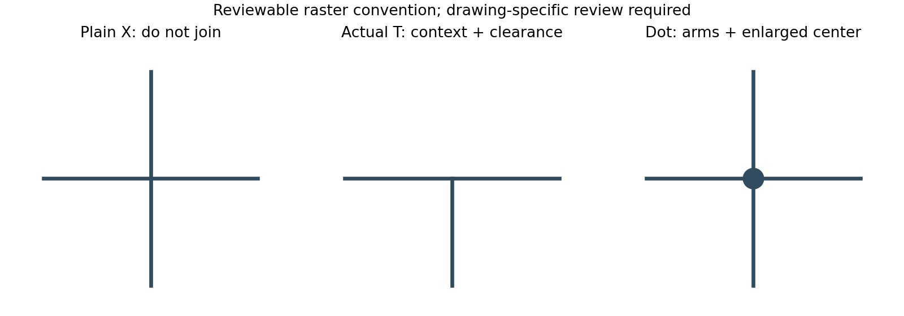
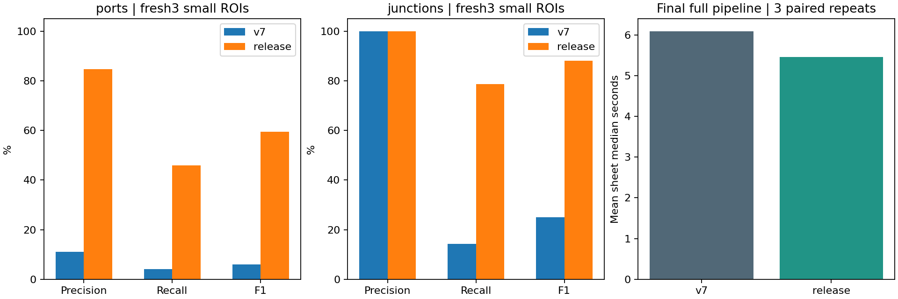
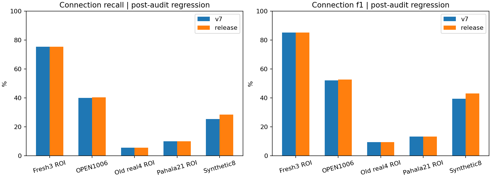

# 포트·접속점 오검출 및 연결 추적 개선 v8-R2

**결과:** 실제 점 주석으로 학습한 희소 문맥 모델로 포트·접점 오검출을 줄였다. 기존 실제 OPEN100 6장에서는 보수적인 추가 추적으로 연결 재현율/F1이 소폭 개선됐다. 새 정부 도면3장에서는 점 검출은 개선됐지만 연결 재현율은 그대로다. 독립 프로젝트에서 연결 개선을 입증한 결과는 아니다.

## 구현

- 포트/접점 주변 24·48px 패치, HOG·잉크 격자·방향별 선 지지·경계 기하794차원으로 CPU RTrees 두 개를 학습했다. 기존 기호 YOLOX-Nano 가중치·해상도·박스를 유지해 토폴로지 변경 효과를 비교했다.
- 반복 점선과 짧은 줄기를 포함하는 선분, 기호 경계 접촉, 실제 선의 팔과 확대된 점 표시를 결합한다. 기호·OCR 문자 내부 접점과 중복 좌표를 제외하고 2팔 꺾임은 접점 목록에서 뺀다. 점 없는4팔 X는 비접속으로 처리하며 도면별 확인이 필요하다.
- 기존 연결 후보를 보존하고 새 경로만 포트 점수≥0.75·양 끝 기호 점수≥0.8·접점 점수≥0.45로 제한한다. 실제 팔/문자 제외 기준도 표시 접점과 맞췄다. 새 경로는 단순화 후 최대4점(두 꺾임)이며 긴 추론 사슬의 오접속 증폭을 막는다. 표시 점수는 보정되지 않은 트리 투표율로 공학적 확률이 아니다.
- 전체 연결500·기호200·선5000·점 제안6000·표시 접점500·표시 선750·경로128점 상한. DXF 원시 기하 연결은 유지한다. 새 연결도 모두 needs_review이며 요소/연결 승인이 포트·접점 승인은 아니다.
- 전체 페이지 6채널 CNN 추론을 점 주변 특징 추론으로 바꾸고 경계 교차·팔 계산을 벡터화했다. 토폴로지 CNN 타일은0, 기존 기호4800px/뷰어2400px 상한은 유지한다.

## 실제 정답·학습·평가 분리

수동 학습은 공개 정부 문서8개 영역의71포트·31개 접점 양성/음성 표본, OPEN1000–3에서 시각 검토한60개 점이다. 원본에 보이는 위치·팔·점 표시를 직접 전사하고 Hough 원형 좌표는 보조로만 사용했다. 단일 AI 주석자이며 사람 전문가의 독립 이중 검수/공학 인증 GT가 아니다. OPEN1000–3·합성12장의 약한 GraphML 포트와 별도 절차적300장도 함께 썼다. 약한 정답은 픽셀의 실제 점 표시를 보장하지 않아 수동 정답과 구분했다. 운영 사용자 업로드는 학습하지 않았다.

검증9장·5출처 그룹은 OPEN1004/5·합성4장·Pahala20·Virden7·Ruttan62이다. 검증 포트38개·접점5개. 원본만 보고 Ruttan62의 누락 T2개를 보강한 이력은 v8/VALIDATION-LABEL-AUDIT.json에 기록했다. 테스트 정답을 고치거나 검증을 테스트로 보고하지 않았다.

처음 만든 R1의 새3장(Virden10/12·Pahala18)에서 연결 재현율이 개선되지 않았다. 해당3장을 R2 학습으로 명시 전환하고 실제 검은 점 버스 예시를 추가했다. 이전 v7 테스트3장도 학습에 들어갔다. 두 집합의 학습 적합 결과는 아래에서 별도 분리하며 새 테스트로 세지 않는다.

R2의 새 정답은 **Pahala14·Virden13/14의3개 작은 영역:18기호·61연결·24포트·14접점**이다. 원본 선택·정답·점 모델·초기 임계값을 첫 R2 추론 전에 고정했다. 기존 프로젝트의 다른 페이지이므로 독립 프로젝트 평가가 아니다. Pahala14의55연결은 한 계기 버스의 상관된 쌍이며55개 독립 네트워크가 아니다. 전체 페이지로 추론하되 지정 ROI 내 모든 후보를 평가하고 미검출 기호의 포트도 FN으로 센다. 기호 IoU≥0.5, 같은 기호 포트6px 이내 일대일 대응, 접점은6px와 종류가 맞아야 한다.

Pahala17은 붙어 있는 계기 조립체의 기호 경계·내부 연결이 모호해 추론 전에 제외했다. 원본 PLAN의 four pages 문구는 오래된 초안이며 실제 고정 정답은3장이다. OPEN100 공식 아카이브는 실제0–11뿐이어서12/13을 만들거나 다른 자료로 대체하지 않았다.

## 새3장: 점 검출과 연결

| 항목 | 버전 | TP / FP / FN | Precision / Recall / F1 |
|---|---|---|---|
| ports | v7 | 1 / 8 / 23 | 11.11% / 4.17% / 6.06% |
| ports | release | 11 / 2 / 13 | 84.62% / 45.83% / 59.46% |
| junctions | v7 | 2 / 0 / 12 | 100.00% / 14.29% / 25.00% |
| junctions | release | 11 / 0 / 3 | 100.00% / 78.57% / 88.00% |

**포트 FP8→2, 접점 FP0→0.** 새 집합에서는 기존 접점도 FP가0이어서 접점 오검출 감소를 이 집합에서 주장하지 않는다. 포트 F1 6.06%→59.46%, 접점 F1 25.00%→88.00%다. 접점 개선은 주로 Pahala14의 검은 점9/10개 회복이다.

| 새 영역 | 포트 TP/FP/FN | 접점 TP/FP/FN | 연결 TP/FP/FN |
|---|---|---|---|
| pahala-p14 | 10/0/1 | 9/0/1 | 46/0/9 |
| virden-p13 | 0/0/6 | 0/0/2 | 0/0/2 |
| virden-p14 | 1/2/6 | 2/0/0 | 0/1/4 |

연결은 두 버전 모두46TP/1FP/15FN, 재현율 75.41%, F1 85.19%다. Pahala14는 기호11개가 모두 대응하지만9개 버스 연결을 놓쳤다. 포트 하나가 누락되고 가지/점선 추적도 검토가 필요하다. Virden13은 기호3개를 모두 놓쳐 두 연결을 복원하지 못한다. Virden14도4기호 중 PI만 맞춰4개 정답 연결을 놓쳤다. 새 영역의15개 누락 중 기호 누락 영향6개, 검출된 끝점 사이 추적 누락9개다. 기호 탐지 병목을 포트 모델만으로 해결하지 못했다.

## 연결 규칙의 오류 분석과 회귀 결과

초기 R2는 실제 OPEN100에서339TP/112FP/509FN→351TP/160FP/497FN으로 재현율은 오르지만 F1이52.19→51.66%로 떨어졌다. 기호 신뢰도 제한만으로는 해결되지 않았다. 실제 팔·OCR 제외·표시 임계값 통일도 긴 경로의 오접속을 충분히 막지 못했다. 경로 점 상한2/3/4/5를 사후 진단하고 최종 상한3/4를 고정 검증셋의 출처별 정밀도 보존 조건으로 비교해4를 선택했다. 검증 출처 평균 F1은33.05→33.78%다.

**중요한 평가 한계:** 최종 그래프 규칙은 기존 평가의 실패를 본 뒤 개발했다. 아래 연결 결과는 사후 회귀·개발 결과이며 블라인드 일반화 성능이 아니다. 새3장의 점 모델·좌표·유형·점수는 초기 고정 상태를 유지했으므로 위 점 검출 결과와 구분한다. 접점의 connected 표시와 경로 가설은 새 규칙을 따른다. [전체 감사 기록](GRAPH-AUDIT.json), [검증 선택](STRICT-RELEASE-SELECTION.json)을 남겼다.

| 집합 | 버전 | 연결 TP / FP / FN | 연결 P / R / F1 |
|---|---|---|---|
| 새3장 작은 ROI | v7 | 46 / 1 / 15 | 97.87% / 75.41% / 85.19% |
| 새3장 작은 ROI | release | 46 / 1 / 15 | 97.87% / 75.41% / 85.19% |
| OPEN100 기존6장 | v7 | 339 / 112 / 509 | 75.17% / 39.98% / 52.19% |
| OPEN100 기존6장 | release | 343 / 113 / 505 | 75.22% / 40.45% / 52.61% |
| 기존 정부 도면4 ROI | v7 | 2 / 4 / 34 | 33.33% / 5.56% / 9.52% |
| 기존 정부 도면4 ROI | release | 2 / 4 / 34 | 33.33% / 5.56% / 9.52% |
| Pahala21 기존 ROI | v7 | 1 / 4 / 9 | 20.00% / 10.00% / 13.33% |
| Pahala21 기존 ROI | release | 1 / 4 / 9 | 20.00% / 10.00% / 13.33% |
| 합성 기존8장 | v7 | 1674 / 211 / 4912 | 88.81% / 25.42% / 39.52% |
| 합성 기존8장 | release | 1873 / 233 / 4713 | 88.94% / 28.44% / 43.10% |

OPEN100 실제6장에서는 정답4쌍·오연결1쌍이 추가되어 재현율39.98→40.45%, F152.19→52.61%다. 합성8장도 개선되지만 실제 도면 개선으로 대체해 해석하지 않는다. 기존 정부4영역/Pahala21에서는 개선되지 않았다. 따라서 모든 도면에서 새 추적기가 우수하다고 결론내리지 않는다.

학습으로 전환한6영역은 별도 진단이다. R1→학습3영역의 포트 FP59→4·접점 FP2→0, v7→학습3영역의 포트 FP8→0·접점 FP14→0이다. 학습에 직접 들어간 영역의 결과여서 일반화 근거로 쓰지 않는다. 검증 접점도 TP1/FP18/FN4→TP2/FP9/FN3으로 오검출이 줄었지만5개뿐이며 임계값 선택 집합이다.

## 처리 시간과 재현

원래 R2 전체 평가는28장177회(새3장3버전·나머지25장2버전,각3회)다. 28장 모두 기호 박스 유지·기존 연결 보존·반복 결과 결정성을 검사했다. 최종 규칙의 그래프 재생은 같은 기호·원본 픽셀·비공개 OCR을 사용하고, 규칙을 끄면 원래 R2 전체 연결과28장 모두 정확히 일치함을 먼저 확인했다. 그래프 재생 시간은 전체 파이프라인 속도로 제시하지 않는다.

최종 릴리스는 새3장에서 실제 OCR+기호+추적/인식을 다시18회 실행해 그래프 재생 및 점 출력과 대조했다. 순차 교대3회 중앙값의 장별 평균은 **6.092초 → 5.451초 (10.5% 단축)**다. CPU OpenCV2threads/OMP1, 디코딩·PDF 렌더링·네트워크·저장 제외이며 Pod SLA/동시 처리량이 아니다. R2 원래 시간과 최종 시간을 섞지 않는다.

[원본 전체 실행](results/report.json) · [최종 그래프 회귀](guard-results/report.json) · [최종 전체 실행/시간](RELEASE-TIMING.json) · [원래 고정](FROZEN.json) · [릴리스 고정](FROZEN-RELEASE.json) · [재현](README.md)

다음 우선순위는 미검출 밸브·계기와 짧은 가지/점선의 실제 전문가 정답, 별도 프로젝트의 블라인드 평가, 포트·접점 직접 수정/승인 UI다. 이 버전은 자동 공학 판정기가 아닌 검토 후보 추출기다.

원본: [PID2Graph/OPEN100](https://zenodo.org/records/14803338), [Virden](https://www.gov.mb.ca/sd/eal/registries/5697virden/2019-04-26_5697_00_phase_2_p_and_i_drwngs.pdf), [Pahala](https://www.epa.gov/system/files/documents/2021-08/pahala-wwtp-design-build-drawings-2021-07-23.pdf), [Ruttan](https://gov.mb.ca/sd/eal/registries/294.30/20250618_letter.pdf). 공개 호스팅을 원본 재배포 허락으로 간주하지 않는다. 정부 PDF/페이지/잘라낸 이미지/전체 OCR은 Git에서 제외했다. 이 보고서 차트·개념도는 직접 생성했다.

[모델 카드](MODEL-CARD.ko.md) · [가중치 출처](../../backend/assets/NOTICE-v8r2.md) · [운영 배포 검증](../../DEPLOYED_V8_VERIFICATION.ko.md)
