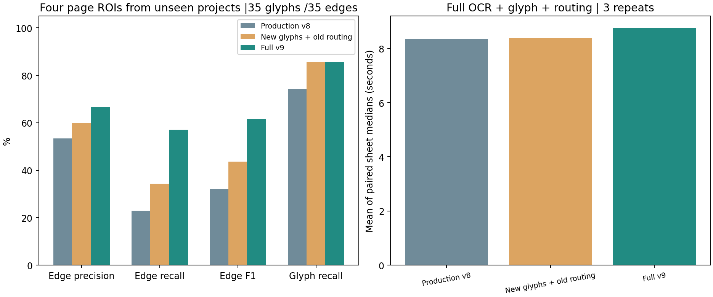
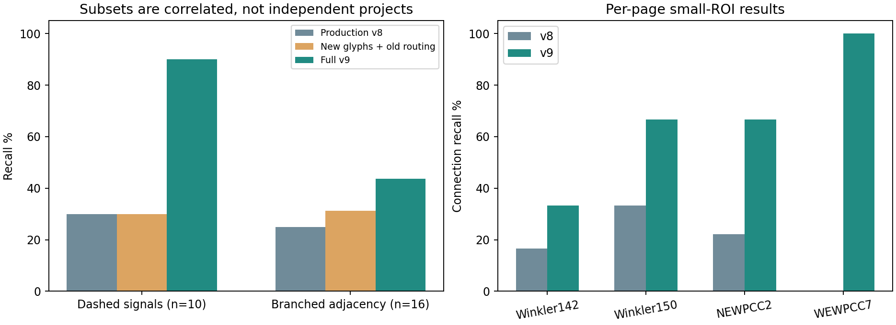
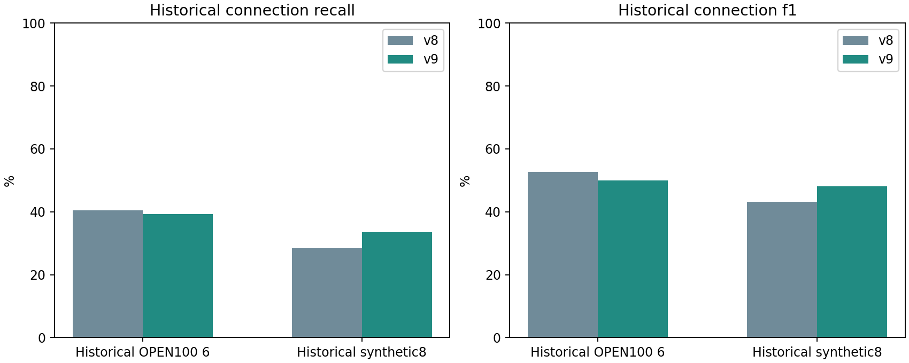

# 새 프로젝트 기호 누락·가지·점선 개선 v9

**최종 결과:** 학습/선정에 쓰지 않은 Winkler·Winnipeg 자료집의3개 시설 사업,4개 작은 영역에서 기호 누락과 연결 누락이 줄었다. 같은35개 정답 연결을 합산해 재현율 22.86%→57.14%, F1 32.00%→61.54%다. 새 기호 모델만 바꾼 비교도 함께 실행해 추적 규칙의 기여를 분리했다.

## 바꾼 부분

- **기호 검출:** YOLOX-Nano를 이전 실제 도면의 누락 사례로 추가 미세조정했다. 작은 ROI가 학습에서 과도하게 커지는 문제를 줄이도록0.35–1.0 축소·무작위 배치 증강을 비교했고 검증으로 scale8을 선택했다. 단일 일반 기호 위치 검출이며 종류·국제표준 ID를 자동 승인하지 않는다.
- **가지·점선:** 모폴로지 닫기는 제안에만 쓰고 반복된 실제 잉크·유한 간격·주기성을 확인해 긴 점선 구간을 복구한다. 짧은 끝점3px 보정으로 기호 경계 접촉을 보완하고, 실제 팔/점 표시와 문자·기호 내부 제외로 교차를 검토한다. 점 없는4방 X는 비접속 관례를 유지한다.
- **계산량:** 점선 방향 샘플을 배치 계산하고 새 모델의 추가 확대 타일은 검증에서 선택하지 않아0개다. 최대4800px 기호/2400px 미리보기, 기존36+전체1타일·기호200·연결500 예산을 유지한다. 더 큰 출력 예산으로 재현율을 올리지 않았다.
- **선택하지 않은 실험:** 저신뢰 후보 확대, 형상 포트 힌트 확대, 짧은 두 점선의 직접 연결, 기존 판정의 완전 대체도 개발 검증에 기록했다. 최종 효과를 이 미선택 기능의 효과라고 설명하지 않는다.

## 데이터와 평가 범위

학습은 기존 OPEN100/Pahala/Virden/Ruttan의 실제20페이지(부분 ROI·상관된 개정 포함)와 합성12장이다. 이전 테스트10페이지의73기호를 **이번 학습으로 명시 전환**해 기존607타일에162타일을 더했다. 원천1,332기호·파생769타일이며 독립 도면769장이 아니다. 운영 업로드는 학습하지 않았다. v6 선택 epoch16→첫12단계 중4→축소 증강8단계 중8로 미세조정했다.

검증은 기존10페이지·4출처 그룹이다. 기호 F1로 두 체크포인트 계열을 줄인 뒤, 출처 평균(connectionF1+.25symbolF1)로 추적 조합을 선택했다. 이 합성 목적함수는 정확도%가 아니다. 기준선0.5230→최종0.6488이며 모든 개발 반복과 기준선을 남겼다. 최종 문턱은 기호0.6, 포트0.45, 접점0.35, 추가 경로 점수0.5·끝 기호0.45·최대8점이다. 점수는 보정된 공학적 확률이 아니다.

새 자료는 Winkler WWTP project60430450의05-N001/05-N009, Winnipeg NEWPCC BNR upgrade Contract3의RAS 도면, WEWPCC의WEP-91이다. 두 자료집이 실제3개 시설 사업을 포함한다. PDF/이미지 SHA와 학습 미포함 확인은 [분리 감사](SPLIT-AUDIT.json)에 있다. 같은 설계회사·관례가 다른 프로젝트에도 나타날 수 있어 조직/양식의 완전한 독립을 의미하지 않는다.

정답은 **단일 AI 주석자가 원본을 보고 전사한35기호·35연결**이며 전문가 인증/독립 이중 검수 정답이 아니다. 전체 페이지로 추론하되 지정 영역의 모든 후보를 평가한다. 기호 IoU≥0.5 일대일 대응과 중간 의미 기호에서 정지하는 무방향 인접 관계를 사용한다. 미검출 기호의 연결도 FN이다. 관로 축소부·불명확한 트랩 형상·독립 명칭 타원·지지 브래킷의 명시적 제외는 정답 파일에 있다. Winnipeg7은 복잡한 제어 조립체 내부가 모호해 추론 전에3기호의 작은 점선 연쇄를 선택했다. 전체 도면 정확도로 확장하지 않는다.

## 검증·실행 불일치 수정 이력

최초 실행은 export sidecar의 replace 병합값을 그대로 복사하는 구현 오류로, 신경망 후보만 쓴 검증과 달리 이전 형상/HOG 후보도 섞였다. 합성 회귀에서 오검출 급증을 확인했고 **그 후보는 배포하지 않았다.** 이미 선택한 신경망 후보 집합 neural_only를 구현하도록 교정했다. 정답·가중치·문턱값·추적 규칙은 바꾸지 않았다.

최초 실행은 [초기 비정상 결과](invalid-merge-run/README.md)에 보존하고 최종 수치에서 제외했다. 새 프로젝트는 여전히 학습/문턱값 선택에 쓰이지 않았지만, 수정 후 첫-ever 입력 노출인 블라인드 실행이라고 표현하지 않는다. [수정 기록](VALIDATION-CONTRACT-FIX.json), [최종 고정](FROZEN-RELEASE.json), [실행 후보 계약 테스트](../../tests/test_neural_symbols.py)를 제공한다.

## 최종 새 프로젝트 결과

| 버전 | 기호 TP / FP / FN | 기호 P / R / F1 | 연결 TP / FP / FN | 연결 P / R / F1 |
|---|---|---|---|---|
| v8 | 26 / 6 / 9 | 81.25% / 74.29% / 77.61% | 8 / 7 / 27 | 53.33% / 22.86% / 32.00% |
| glyph-only | 30 / 5 / 5 | 85.71% / 85.71% / 85.71% | 12 / 8 / 23 | 60.00% / 34.29% / 43.64% |
| v9 | 30 / 5 / 5 | 85.71% / 85.71% / 85.71% | 20 / 10 / 15 | 66.67% / 57.14% / 61.54% |

기호 누락9→5개·기호 오검출6→5개다. 연결 오검출은7→10개로 늘었으나 정답 연결8→20개를 회복해 정밀도53.33→66.67%도 올랐다. 오연결이 없어진 시스템은 아니며 검토가 필요하다. 기호만 바꾸면12개 연결을 회복하고, 추적 변경을 더하면20개다. 최종 기호 박스가 두 비교에서 같음을 확인했다.

| 사업/영역 | 기호 재현율 v8→v9 | 연결 TP v8→v9 / 정답 | 연결 재현율 v8→v9 |
|---|---|---|---|
| Winkler WWTP upgrade, project60430450 · p142 | 58.33% → 66.67% | 2 → 4 / 12 | 16.67% → 33.33% |
| Winkler WWTP upgrade, project60430450 · p150 | 100.00% → 100.00% | 4 → 8 / 12 | 33.33% → 66.67% |
| Winnipeg NEWPCC BNR upgrade Contract3 · p2 | 63.64% → 90.91% | 2 → 6 / 9 | 22.22% → 66.67% |
| Winnipeg WEWPCC historical aeration/blowers · p7 | 100.00% → 100.00% | 0 → 2 / 2 | 0.00% → 100.00% |

| 부분집합 | v8 | 기호만 교체 | 최종v9 |
|---|---:|---:|---:|
| dashed | 3/10 | 3/10 | 9/10 |
| branch | 4/16 | 5/16 | 7/16 |

점선10개와 가지16개는 같은 도면의 상관된 부분집합이며 독립 네트워크 수나 별도 표본 수로 더하지 않는다. 최종 연결 누락15개는 기호 누락 영향9개·기호가 대응한 뒤 추적 누락6개다. Winkler142의 펌프·작은 밸브·배수/샘플 표지, Winnipeg2의밸브1개는 여전히 검출하지 못했다. [사후 오류 목록](ERRORS.json)은 진단용이며 정답/모델을 고쳐 점수를 다시 선택하지 않았다.

## 처리 시간

같은4장·3버전·3반복=36회 전체 추론을 실행했다. 버전 순서를 회전시키고 박스·연결·포트·접점·관찰 경로의 결정성을 확인했다. OCR+4800px 기호+2400px 추적/인식의 장별3회 중앙값 평균은 **8.370초 → 8.765초, 4.7% 증가**다. 기호만 교체한 경우 8.385초라서 추가 비용은 주로 복구/추적에 있다. 속도가 빨라졌다고 주장하지 않는다.

CPU OpenCV2threads/OMP1이며 디코딩·PDF렌더·네트워크·저장은 제외한다. 다른 도면으로 측정한 이전5초대 수치와 직접 비교하지 않는다. Pod SLA·동시 처리량·메모리 최고치를 뜻하지 않는다.

## 기존 도면 회귀

기존 OPEN100 6장·합성8장·검증용 이전 ROI3장은 각 버전1회, 총34회로 품질을 확인했다. 합성 원본7168px은 미리보기/기호 영상을 원본에서 독립 축소하도록 재실행했다. 새4장 원본4800px의 입력 픽셀이 변하지 않음을 확인했으며 REGRESSION-PROTOCOL.json에 기록했다. 새 프로젝트 근거나3반복 속도 통계와 섞지 않는다.

| 집합 | 버전 | 연결 TP / FP / FN | 연결 P / R / F1 |
|---|---|---|---|
| open100 (기존 회귀) | v8 | 343 / 113 / 505 | 75.22% / 40.45% / 52.61% |
| open100 (기존 회귀) | v9 | 333 / 151 / 515 | 68.80% / 39.27% / 50.00% |
| synthetic (기존 회귀) | v8 | 1873 / 233 / 4713 | 88.94% / 28.44% / 43.10% |
| synthetic (기존 회귀) | v9 | 2212 / 386 / 4374 | 85.14% / 33.59% / 48.17% |
| pahala (검증 진단) | v8 | 46 / 0 / 9 | 100.00% / 83.64% / 91.09% |
| pahala (검증 진단) | v9 | 46 / 0 / 9 | 100.00% / 83.64% / 91.09% |
| virden (검증 진단) | v8 | 0 / 1 / 6 | 0.00% / 0.00% / 0.00% |
| virden (검증 진단) | v9 | 1 / 1 / 5 | 50.00% / 16.67% / 25.00% |

**기존 실제 OPEN100 6장에서는 연결 재현율40.45→39.27%, F1 52.61→50.00%로 하락했다.** 신규 사업 영역 개선을 모든 양식의 개선으로 해석하면 안 된다. 과거 페이지별 하락도 전체 결과에 포함한다. 새 프로젝트 영역 개선이 모든 도면/양식에서의 개선을 뜻하지 않으며, 이전 운영 문서는 자동 재분석하지 않는다. 포트/접점을 직접 교정하고 전문가 검수 정답을 쌓는 기능, 누락된 펌프/작은 표지의 추가 학습과 별도 사업의 후속 평가가 다음 우선순위다.

모든 출력은 needs_review이며 설비 종류·표준 번호·물리 흐름·변경 영향의 자동 승인으로 쓰지 않는다. [재현/역할](README.md) · [모델 카드](MODEL-CARD.ko.md) · [최종 전체 결과](results/report.json) · [회귀](regression/report.json) · [배포 검증](../../DEPLOYED_V9_VERIFICATION.ko.md)

원본: [Winkler](https://www.manitoba.ca/sd/eal/registries/2708.2winkler/nov2016noa.pdf), [Winnipeg](https://www.winnipeg.ca/finance/findata/matmgt/documents/2015/382-2015/382-2015_ADDENDUM_2/382-2015_Addendum_02-Appendix_M_PID_Drawings.pdf), [PID2Graph](https://zenodo.org/records/14803338). 정부 호스팅을 원본 재배포 허락으로 간주하지 않는다. 원본 PDF/페이지/전체 OCR은 Git과 컨테이너에서 제외하며 차트는 직접 작성했다.
